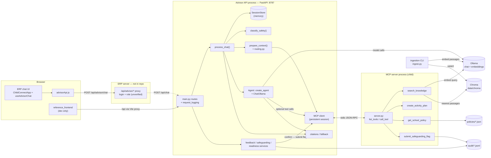

# ARCHITECTURE.md — Components and how they connect

> **Question this document answers:** *What are the parts of the Advisor application, what is each responsible for, how do they connect, and how does information travel between them?*
>
> For the function-by-function path see [FLOW.md](FLOW.md); for one request traced end to end see [REQUEST_LIFECYCLE.md](REQUEST_LIFECYCLE.md); for *why* things are built this way see [DECISIONS.md](DECISIONS.md).

**Snapshot:** the working tree on 2026-10-26, after the changes recorded as DEC-026 – DEC-034. Much of this code is not yet committed to git. Statements are based on reading the source; anything not verifiable from this repository is marked **(unverified)** and anything reasoned rather than read is marked **(inferred)**.

---

## A. System overview

### What the application does

The Advisor is a **chat assistant for parents and teachers of preschool children (ages 2–5)**. A user asks a practical question ("my child won't share toys", "what is our bullying policy?", "make me a 5-day turn-taking plan") and receives:

- a short, practical answer written by a **local** language model,
- the **knowledge-base passages** the answer was based on (as citations),
- a **structured activity plan** or the **real school policy text** when asked for,
- a suggested follow-up question.

Messages that look like a crisis (self-harm, abuse, emergencies) or need a professional (developmental concerns) **never reach the AI**: they get a fixed safety reply instead, with an optional "log this concern" button.

### Who uses it

Logged-in users of the school ERP (the school's management web app) open the page at `/advisor`. They choose **Parent** or **Teacher** mode and the **child's age** in a sidebar, then chat. A developer can also run a standalone copy of the same UI locally (`reference_frontend/`).

### The major parts, in one paragraph

The **browser UI** (React) sends the question over HTTP to the **ERP web server**, which forwards it to the **Advisor API** (FastAPI, Python, port 8787). The API checks the message with a **rule-based safety gate**, keeps short **conversation history in memory**, gathers context by calling **tools** that live in a **separate MCP server process** (knowledge search over a **Chroma** vector store, school policy lookup, activity-plan templates), and then asks a **LangChain agent** backed by an **Ollama**-served model to write the answer. Citations are built from the search results, not from the model's text. Feedback and safeguarding confirmations are written to **append-only log files**. A separate **ingestion command** builds the vector store ahead of time.

### Boundaries at a glance

| Boundary | What crosses it | How |
|---|---|---|
| Browser ↔ ERP server | JSON chat requests/responses, login cookie | HTTPS/HTTP `fetch` to `/api/advisor/*` |
| ERP server ↔ Advisor API | the same JSON | HTTP to `/api/*` on port 8787 **(unverified — ERP code not in repo)** |
| Advisor API ↔ MCP server | tool names, arguments, JSON results | MCP JSON-RPC over the child process's **stdin/stdout** |
| Advisor API / MCP server ↔ Ollama | prompts and replies; texts and embedding vectors | HTTP to `http://127.0.0.1:11434` (default) |
| MCP server ↔ Chroma | query vectors, passages + metadata | in-process library calls on files in `backend/data/chroma` |
| Ingestion CLI ↔ Chroma / Ollama | passages, vectors | library calls / HTTP — a separate, manual run |

---

## B. Component inventory

Runs-in key: **Browser** = user's web browser · **API** = the uvicorn/FastAPI Python process · **MCP child** = the separate Python process the API starts · **External** = another program not in this repo · **CLI** = run by hand.

| # | Component | Purpose | Source | Inputs → Outputs | Depends on | Runs in |
|---|---|---|---|---|---|---|
| 1 | **ERP chat UI** (ChildConnect) | Chat screen, mode/age controls, renders answers, sources, plans, safety panels | `erp-integration/src/components/Communication/AdvisorPage.js`, `.../advisor/ChildConnectApp.js`, `useAdvisorChat.js`, `components/*.js`, `markdown.js` | user typing/clicks → HTTP requests; JSON responses → rendered UI | ERP's `getConfig()` (unverified), API client (#2) | Browser (inside the ERP React app) |
| 2 | **Frontend API client** | Builds URLs, sends `fetch`, maps HTTP errors to friendly messages | `.../advisor/advisorApi.js` | payload → parsed JSON or `Error` | ERP proxy (#4) | Browser |
| 3 | **Dev UI** | Standalone copy of the UI for local work; Vite proxies `/api` to 8787 | `reference_frontend/src/*`, `reference_frontend/vite.config.js` | same as #1 | Advisor API directly | Browser + Vite dev server |
| 4 | **ERP proxy** | Login/role check; forwards `/api/advisor/*` → `/api/*` | live ERP **(unverified)**; helper `erp-integration/server/registerAdvisorProxy.js` | browser request → forwarded request | Advisor API | External (ERP server) |
| 5 | **HTTP API layer** | App creation, CORS, request logging, 5 routes, startup/shutdown | `backend/app/main.py`, `backend/app/models.py` | HTTP JSON → validated Pydantic objects → JSON responses | services (#6–#9), MCP client (#12) | API |
| 6 | **Chat pipeline** | Orders the steps of one chat turn; picks agent vs fallback | `backend/app/services/advisor.py` (`process_chat`) | `ChatRequest` → `ChatResponse` | #7, #8, #9, #10, #11 | API |
| 7 | **Safety gate** | Regex classification: urgent / referral / normal | `backend/app/safety.py` | message text → `SafetyResult` | — | API |
| 8 | **Session store** | Recent turns per `session_id`, TTL and caps | `backend/app/sessions/store.py` | session id + messages → history list | config | API (memory only) |
| 9 | **Context builder + router** | Always runs knowledge search; runs policy/plan tools when the message clearly asks | `backend/app/agent.py` (`prepare_context`), `backend/app/routing.py`, `backend/app/plan_params.py`, `backend/app/services/retrieval.py` | request + history → `TurnContext` (hits, policy, plan) | MCP client (#12) | API |
| 10 | **Agent** | LLM tool-calling loop that writes the answer | `backend/app/agent.py` (`run_advisor_agent`), `backend/app/prompts.py` | prompt + 3 read-only tools → final text (+ any extra tool results) | Ollama (#17), MCP client (#12) | API (model runs in Ollama) |
| 11 | **Citations & response assembly** | Citations from search hits only; strip model "Sources"; fallback templates | `backend/app/citations.py`, `backend/app/tool_payload.py`, `agent.py` (`_resolve_citations`, `run_fallback_via_mcp`) | hits + agent messages → `Citation` list, answer text | — | API |
| 12 | **MCP client** | One long-lived session to the tool process; per-call fallback | `backend/app/mcp/client.py` (re-exported by `backend/app/mcp_client.py`) | tool name + args → result dict / LangChain tools | MCP server (#13) | API |
| 13 | **MCP server** | Lists tools (schemas from Pydantic), validates arguments, dispatches | `backend/mcp_server/server.py`, `backend/mcp_server/tool_inputs.py` | JSON-RPC requests → JSON text results | tools (#14) | MCP child |
| 14 | **Tools** | `search_knowledge`, `create_activity_plan`, `get_school_policy`, `submit_safeguarding_flag` | `backend/mcp_server/tools/*.py` | validated args → dicts | Chroma (#16), Ollama embeddings (#17), policy JSON, audit files | MCP child |
| 15 | **Feedback / safeguarding / readiness services** | Record ratings; confirmed safeguarding write via MCP; health checks | `backend/app/services/feedback.py`, `safeguarding.py`, `readiness.py` | route bodies → status objects | audit files, MCP client, Chroma | API |
| 16 | **Vector store** | Stores 20 passages, 768-dim vectors and metadata; nearest-neighbour search | Chroma files in `backend/data/chroma/` (collection `advisor_kb`) | query vector → top-k passages + distances | — | Library inside MCP child / CLI (data on disk) |
| 17 | **Ollama** | Serves the chat model (`OLLAMA_CHAT_MODEL`) and the embedding model (`nomic-embed-text`) | configured in `backend/app/config.py`; called via `langchain_ollama` | prompts → completions; texts → vectors | GPU/CPU | External |
| 18 | **Ingestion** | One-off build of the vector store from seed passages | `backend/ingestion/ingest.py`, `backend/ingestion/seed_chunks.json` | seed JSON → Chroma collection | Ollama embeddings, Chroma | CLI |
| 19 | **Data files** | Mock school policy; append-only audit logs | `backend/data/policies/poc_test_school.json`, `backend/data/audit/*.jsonl` | — | — | Disk |
| 20 | **Configuration** | Typed settings from env vars / `backend/.env` | `backend/app/config.py` (`settings`) | env → `Settings` object | — | API **and** MCP child (each reads it) |
| 21 | **Observability** | Per-request trace and timing logs (no message text) | `backend/app/observability.py`, `backend/app/ollama_profile.py` | events → log lines | LangChain callbacks | API |

---

## C. Architecture diagram

Notes on the diagram:
- The agent is given **only three** tools; `submit_safeguarding_flag` is reachable only through the `/api/safeguarding/confirm` route (DEC-028).
- `readiness.check_chroma()` opens Chroma **from the API process directly** (not shown as a separate edge to keep the diagram readable — see §F).
- The ingestion CLI is a **separate run**, not part of the request path.

---

## D. Technology stack

Versions are what is installed in `backend/.venv` (requirements only set minimums with `>=`).

| Layer | Technology | Role here | Where in code |
|---|---|---|---|
| Frontend framework | **React** (ERP: version unknown; dev UI: `latest` via Vite) | UI components, state hooks | `erp-integration/src/components/Communication/advisor/`, `reference_frontend/src/` |
| Frontend tooling | **Vite** | Dev server + `/api` proxy for `reference_frontend` | `reference_frontend/vite.config.js` |
| Browser HTTP | **`fetch`** | Calls the API (no timeout set) | `advisorApi.js::advisorFetch` |
| Backend framework | **FastAPI** 0.141 on **Uvicorn** 0.53 | Routes, validation, CORS, lifespan | `backend/app/main.py` |
| Schemas / config | **Pydantic** 2.13, **pydantic-settings** 2.15 | Request/response models, tool input schemas, env settings | `models.py`, `mcp_server/tool_inputs.py`, `config.py` |
| LLM serving | **Ollama** (external) | Runs the chat model and embedding model locally | `config.py` (`ollama_*`), `agent.py::chat_ollama_kwargs` |
| Chat model | `qwen3.8:latest` configured (27B); `mistral` 7B used in testing | Writes answers, may request tools | `.env` / `config.py` — see `DECISIONS.md` R23 (configured model cannot load on the 12 GB GPU) |
| Agent framework | **LangChain** 1.4 `create_agent` on **LangGraph** 1.2 | Model ↔ tool loop with recursion limit | `agent.py::_compiled_advisor_agent` |
| LLM client | **langchain-ollama** 1.1 (`ChatOllama`, `OllamaEmbeddings`) | HTTP calls to Ollama | `agent.py`, `embeddings.py` |
| Tool protocol | **MCP** Python SDK 1.30 (server), **langchain-mcp-adapters** 0.3 (client) | Separate tool process over stdio | `mcp_server/server.py`, `app/mcp/client.py` |
| Embeddings | **nomic-embed-text** via Ollama (768 dims) | Vectors for passages and queries | `embeddings.py`, `ingest.py`, `search_knowledge.py` |
| Vector database | **ChromaDB** 1.5 `PersistentClient` (embedded, on disk) | Nearest-neighbour search, metadata | `search_knowledge.py`, `ingest.py`, `readiness.py` |
| Retrieval approach | Retrieval-first RAG, top-4, L2 distance cutoff 0.9, no chunking | Grounding + citations | `agent.py::prepare_context`, `search_knowledge.py` |
| Transport | HTTP/JSON (browser↔ERP↔API, API↔Ollama); JSON-RPC over stdio (API↔MCP) | — | see §A boundaries |
| Persistence | In-memory dict (sessions); JSONL files (audit); JSON file (policy); Chroma files | — | `sessions/store.py`, `services/feedback.py`, `tools/safeguarding.py`, `data/` |
| Testing | **pytest** + pytest-asyncio; fake model/tools; live integration tests | — | `backend/tests/` |
| Dev/deploy scripts | PowerShell / bash | Run dev servers; copy UI into ERP | `scripts/run_dev.*`, `erp-integration/apply-to-erp.ps1` |

**Not present:** cloud LLM APIs, a database server, Docker, CI configuration, authentication in the Advisor API, streaming responses.

---

## E. Data flow and component interactions

The detailed traces live in [REQUEST_LIFECYCLE.md](REQUEST_LIFECYCLE.md) (one request, step by step) and [FLOW.md](FLOW.md) (all paths, call chains). Here is the information flow at component level:

| Step | Information | From → To | Shape |
|---|---|---|---|
| 1. User input | question, mode, age | UI → API client | JS object `{message, audience, age_band, language, session_id}` |
| 2. Transport | same, as JSON | browser → ERP proxy → API | HTTP POST |
| 3. Validation | parsed request | FastAPI → `ChatRequest` | invalid → HTTP 422, nothing else runs |
| 4. Session | history in, user turn stored | pipeline ↔ session store | list of `{role, content}` |
| 5. Safety | risk level | safety gate → pipeline | urgent/referral ends the turn with a fixed reply |
| 6. Context | search query; policy/plan args | context builder → MCP client → MCP server → tools | JSON-RPC; results back as JSON text → dicts |
| 7. Retrieval | query vector → passages + metadata | `search_knowledge` → Ollama (embed) → Chroma | up to 4 hits with `distance ≤ 0.9` |
| 8. Model input | system prompt + last 6 turns + user prompt containing passages / policy text / plan note | agent → Ollama | chat messages + tool schemas |
| 9. Model output | text and/or tool-call requests | Ollama → agent | `AIMessage`; extra tool calls go through the MCP client |
| 10. Citations | hits → `Citation` objects | context hits + agent search results → citation builder | only retrieval metadata, never model text |
| 11. Response | `ChatResponse` | pipeline → FastAPI → proxy → browser | validated by `response_model` |
| 12. Rendering | answer (Markdown), plan cards, source cards, follow-up, notices | `useAdvisorChat` → `AssistantResponse` | React components |
| Side writes | feedback, confirmed safeguarding concerns | services / tool → `data/audit/*.jsonl` | append-only JSON lines |

When the model is unavailable or fails, steps 8–9 are replaced by a **template answer** built from the same context, and the response carries `degraded: true`.

---

## F. Architectural boundaries and limitations

### Coupling

| Pair | Coupling | Evidence |
|---|---|---|
| UI ↔ API | **Loose** — only the JSON contract | `models.py` ↔ `advisorApi.js` / `AssistantResponse.js`. But no shared types, and drift exists (UI reads `sections`, `refer_to_support`; ignores `extension`). |
| API ↔ MCP server | **Process-separate but code-coupled** | The child imports `app.config`, `app.embeddings`, `app.tenant`; the API imports `mcp_server.tool_inputs` (in `routing.py`) and `mcp_server.tools.search_knowledge` (in `readiness.py`). They must be deployed together from the same `backend/` folder. |
| Agent ↔ model | **Loose** | All model options are in `agent.py::chat_ollama_kwargs`; the model name is a setting. |
| Retrieval ↔ embedding model | **Tight** | Ingestion and query must use the same embedding model; the 0.9 cutoff is calibrated for `nomic-embed-text`. |
| Policy routing ↔ policy data | **Tight** | `PolicyType` literal (`tool_inputs.py`) and keywords (`routing.py`) hard-code the four keys found in `poc_test_school.json`. |
| Chat pipeline ↔ sessions | **Tight to one process** | `session_store` is a module-level dict; a second worker or a restart loses or splits history. |

### Where configuration lives

Centralised in `backend/app/config.py` (`Settings`, read from env and `backend/.env`), read **separately** by the API process and the MCP child (same file, same values). Exceptions that are hard-coded: model temperature (0.3, `agent.py`), Chroma collection name `advisor_kb` (defined twice: `ingest.py` and `search_knowledge.py`), policy types, plan templates, safety patterns, follow-up templates. The ERP-side forwarding URL (`ADVISOR_BACKEND_URL`) lives on the ERP server. Variable-by-variable details: [CODEBASE_GUIDE.md §E](CODEBASE_GUIDE.md#e-configuration-and-startup).

### External dependencies

Ollama (must be running, with both models pulled into the model store it reads — see `DECISIONS.md` R24), the ERP server and its login, the browser. Chroma is a library, but its data folder must exist (run ingestion).

### What can be replaced independently

| Replace | Touch | Keep |
|---|---|---|
| Chat model | `OLLAMA_CHAT_MODEL` (or swap `ChatOllama` in `agent.py`) | everything else |
| Embedding model | `OLLAMA_EMBED_MODEL` + **re-ingest** + recalibrate `CHROMA_MAX_DISTANCE` | everything else |
| Vector store | `search_knowledge.py`, `ingest.py`, `readiness.check_chroma` | tool contract, citations |
| UI | any client honouring `ChatRequest`/`ChatResponse` | backend |
| Safety rules | `safety.py` + `eval/prompts.json` | pipeline |
| Tool transport | `app/mcp/client.py` (in-process or HTTP MCP) | tools, agent |

### Important limitations and risks

- **The configured chat model cannot run on the server GPU** (27B on 12 GB); every chat then falls back to templates. The owner is changing the model. (`DECISIONS.md` R23)
- **No authentication in the Advisor API** — protection relies on the ERP proxy and on not exposing port 8787 (R4).
- **Single-process state**: sessions in memory; one MCP child per API process; no automatic respawn if the child dies (calls switch to slow per-call mode).
- **Synchronous work inside async code**: tool functions in the MCP child block its event loop, so concurrent tool calls are processed one at a time **(inferred)**; `record_feedback` writes files synchronously in the API.
- **Regex-based safety and routing**: fast and predictable, but phrasing outside the patterns is missed.
- **One school per deployment** (`SCHOOL_ID`), mock contacts and policies.
- **No streaming**: users wait for the whole answer; no frontend timeout.
- Full risk list: [DECISIONS.md §8](DECISIONS.md#8-discrepancies-and-risks-found).

---

## G. Relationship to the other documents

| Document | Answers |
|---|---|
| [DECISIONS.md](DECISIONS.md) | *Why* was each part chosen, what were the alternatives, what did it cost? Also the risk register. |
| [ARCHITECTURE.md](ARCHITECTURE.md) (this file) | *What* are the components and how do they connect? |
| [FLOW.md](FLOW.md) | *How* does execution move through files and functions on every important path (startup, chat, MCP, ingestion, feedback, safeguarding)? |
| [REQUEST_LIFECYCLE.md](REQUEST_LIFECYCLE.md) | *What exactly happens*, in order, when a parent sends one question — with schemas, return paths and branches? |
| [CODEBASE_GUIDE.md](CODEBASE_GUIDE.md) | *Where* is each thing in the code, what does each file do, and where do I change or debug a feature? |
| [LEARNING_ROADMAP.md](LEARNING_ROADMAP.md) | *In what order* should I learn the technologies and read the code, and how do I prove I understand it? |

Older documents: `README.md` (setup and run commands), `backend/tests/README.md` (test layout, partly outdated), `erp-integration/COPY_INSTRUCTIONS.md` and `erp-integration/patches/ADVISOR_WEBSITE_PROXY.md` (ERP installation), and `ADVISOR_AGENT_COMPLETE_PROJECT_GUIDE.md` (a long interview-study guide written **before** the 2026-10-26 changes — useful for concepts, outdated in its code details).
