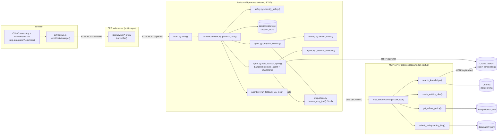
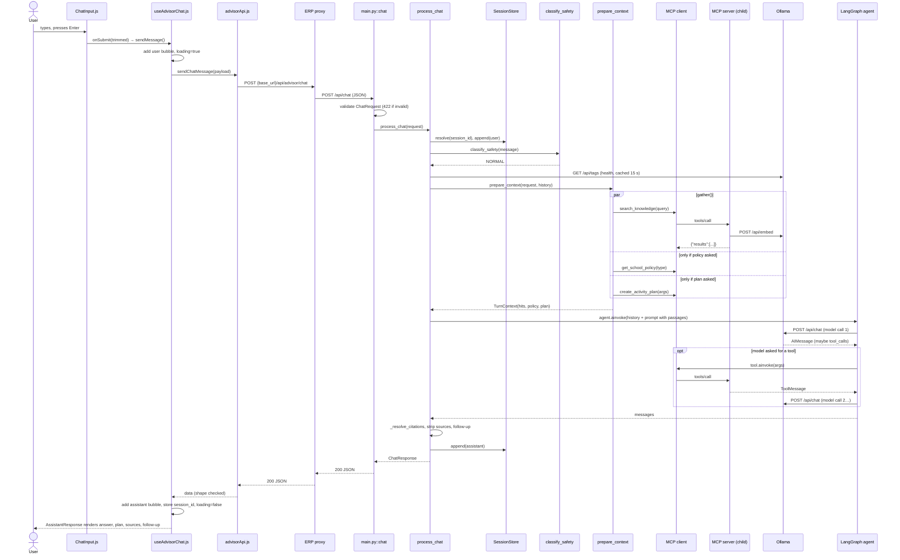
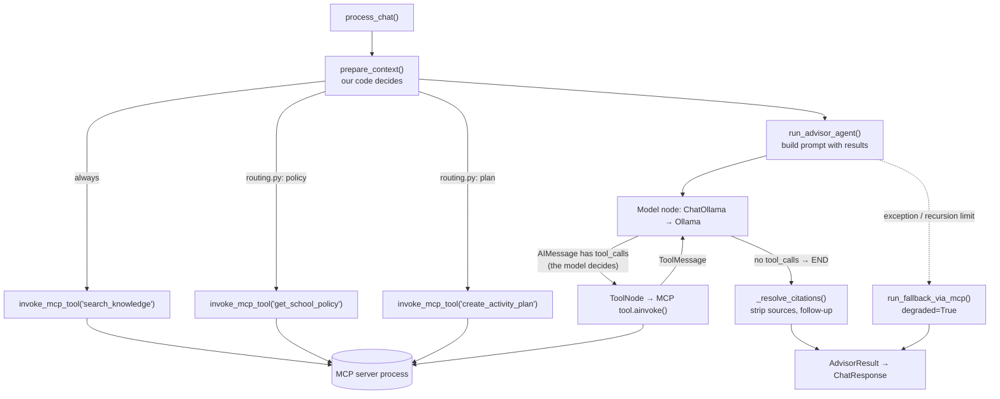
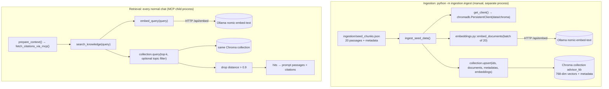

# FLOW.md — How execution travels through the Advisor Agent

> **DECISIONS.md explains *why* the system is built this way. FLOW.md shows *how* a request actually moves through the code**, function by function.

---

## 1. Purpose and scope

This document traces the **real execution paths** in this repository so you can read, debug and change the code with confidence. It was written by reading the source and following calls across files, and it was checked against a live run on 2026-10-26.

**What it covers:** the ERP chat page, the FastAPI backend, the safety gate, sessions, the LangChain agent, the MCP client and server, knowledge retrieval (Chroma + Ollama embeddings), citations, the other API routes, ingestion, async behaviour, errors and debugging.

**What it does not cover:** the school ERP application itself (`lnpl_erp_dev_v1`), which is **not in this repository**. How the ERP mounts the page and forwards `/api/advisor/*` is described only from the files in `erp-integration/` and is marked *unverified*.

**State described:** the working tree on **2026-10-26**, *after* the changes logged as DEC-026 – DEC-034 in `DECISIONS.md`. Much of this code is **not committed to git yet**.

### How to read the call chains

```
path/file.py::function()        a direct Python/JS call
  → calls path/other.py::fn()   the next call, in order
  ⇢ (framework) …               a call made BY a framework (FastAPI, LangGraph, React), not by our code
  ⇒ HTTP POST /api/chat         a network request (separate program or machine)
  ⇒ stdio JSON-RPC              a message to another process through its stdin/stdout pipes
  ← returns X                   the value handed back to the caller
```

### Words you will meet (plain-language glossary)

| Term | Meaning in this project |
|---|---|
| **Entry point** | Where execution *starts*: a command you run (`uvicorn …`), a framework hook (a route function FastAPI calls when a request arrives), or a script's `if __name__ == "__main__"`. |
| **Helper function** | A function that only runs because another function called it, e.g. `trim_history_messages()`. |
| **Function call vs HTTP request** | A function call happens inside one program and is instant. An HTTP request sends bytes over the network to *another* program (e.g. the browser → FastAPI, FastAPI → Ollama) and can fail or time out. |
| **Frontend API client vs backend route** | `advisorApi.js::sendChatMessage()` (in the browser) *sends* the request; `app/main.py::chat()` (on the server) *receives* it. |
| **Agent vs tool** | The *agent* is the loop that lets the LLM decide what to do next. A *tool* is ordinary code (search, plan, policy lookup) that the agent, or our code, can run. |
| **MCP client vs MCP server** | The client (`app/mcp/client.py`, inside the API process) asks for tools and calls them. The server (`mcp_server/server.py`, a **separate Python process**) owns the tools and runs them. |
| **Return value vs side effect** | A return value is handed back to the caller. A side effect changes the outside world: writing a file, calling Ollama, adding to the session store. |
| **Startup vs per-request** | Startup runs once when the API starts (create the app, open the MCP session). Per-request code runs for every chat message. |
| **Session state vs model memory** | The *server* stores recent messages per `session_id` in a Python dict. The *model* remembers nothing: the code re-sends recent history with every request. |
| **async / await** | `async def` functions can pause at `await` while waiting for slow I/O (network, subprocess) so the server can handle other requests meanwhile. |

---

## 2. Repository map and important execution files

Only files that take part in execution are listed. `node_modules/`, `.venv/`, `dist/`, caches and Chroma's binary files are excluded.

```
advisor/
├── backend/                         Python service (FastAPI + agent + MCP)
│   ├── app/
│   │   ├── main.py                  ★ FastAPI app, lifespan, 5 routes, logging middleware
│   │   ├── config.py                Settings (env/.env) → `settings` singleton
│   │   ├── models.py                Pydantic request/response schemas
│   │   ├── safety.py                ★ regex safety gate: classify_safety()
│   │   ├── routing.py               policy / activity-plan intent detection
│   │   ├── plan_params.py           parses "5-day", "15 minutes a day"
│   │   ├── agent.py                 ★ prepare_context(), run_advisor_agent(), fallback
│   │   ├── prompts.py               SYSTEM_PROMPT and template answers
│   │   ├── citations.py             builds/validates citations from search hits
│   │   ├── tool_payload.py          turns MCP tool output into a dict
│   │   ├── embeddings.py            OllamaEmbeddings wrapper (used by ingestion + search)
│   │   ├── observability.py         per-request trace in a ContextVar
│   │   ├── ollama_profile.py        LangChain callback that times model/tool calls
│   │   ├── tenant.py                trusted school id
│   │   ├── mcp/client.py            ★ MCP client: persistent session, invoke_mcp_tool()
│   │   ├── mcp_client.py            re-export of mcp/client.py (agent.py imports this)
│   │   ├── orchestrator.py          re-export only — not imported anywhere (dead)
│   │   ├── rag/retriever.py         documentation-only module (no code)
│   │   ├── services/advisor.py      ★ process_chat(): the chat pipeline
│   │   ├── services/retrieval.py    fetch_citations_via_mcp(): search via MCP
│   │   ├── services/feedback.py     record_feedback(): JSONL append
│   │   ├── services/safeguarding.py confirm_safeguarding(): calls MCP tool
│   │   ├── services/readiness.py    checks for /api/ready
│   │   └── sessions/store.py        ★ in-memory SessionStore
│   ├── mcp_server/
│   │   ├── server.py                ★ MCP stdio server: list_tools(), call_tool()
│   │   ├── tool_inputs.py           Pydantic input models = tool JSON schemas
│   │   └── tools/                   search_knowledge, activity_plan, school_policy, safeguarding
│   ├── ingestion/ingest.py          ★ CLI: embed seed_chunks.json into Chroma
│   ├── ingestion/seed_chunks.json   the 20 knowledge passages
│   ├── data/chroma/                 Chroma store (collection "advisor_kb")
│   ├── data/policies/poc_test_school.json   mock school policy
│   ├── data/audit/*.jsonl           feedback + safeguarding logs (append-only)
│   ├── eval/prompts.json            labelled safety prompts used by tests
│   ├── scripts/profile_chat_latency.py   CLI latency profiler (calls process_chat directly)
│   └── tests/                       unit, fake-model, and live integration tests
├── erp-integration/
│   ├── src/components/Communication/AdvisorPage.js       ★ ERP page (renders ChildConnectApp)
│   ├── src/components/Communication/advisor/             ★ the production chat UI
│   │   ├── ChildConnectApp.js, useAdvisorChat.js, advisorApi.js, markdown.js
│   │   └── components/ (ChatWindow, ChatInput, AssistantResponse, MarkdownText, …)
│   ├── server/registerAdvisorProxy.js   Express-style proxy helper (see §15)
│   ├── apply-to-erp.ps1                 copies the UI into the ERP and patches App.js
│   └── Pages/, src/Pages/               old copies of an earlier page (not used by the canonical page)
├── reference_frontend/              standalone Vite + React dev UI (same ChildConnect design)
└── scripts/run_dev.ps1, run_dev.sh  start backend + dev UI together
```

★ = files on the main chat path.

---

## 3. Entry points and application startup

There are **four kinds of entry point**: commands that start a program, framework hooks that run per request, a tool-server process, and CLIs or scripts.

### 3.1 Backend startup — `uvicorn app.main:app` *(application startup)*

Command (README, `scripts/run_dev.*`): `uvicorn app.main:app --host 127.0.0.1 --port 8787 --reload`, run from `backend/`.

What happens, in order:

1. **Uvicorn imports `app.main`.** Importing a module runs its top-level code:
   - `app/config.py` runs `settings = Settings()`, which reads environment variables and `backend/.env` **once**.
   - `app/services/advisor.py` imports `app/sessions/store.py`, which creates the global `session_store = SessionStore()` (empty dict).
   - `app/agent.py` is imported, which imports LangChain, `langchain_ollama`, `app/routing.py` and `mcp_server/tool_inputs.py`. **No model is created yet.**
   - `logging.basicConfig(level=logging.INFO)`.
2. **`app/main.py` builds the FastAPI app:** `FastAPI(..., lifespan=lifespan)`, adds `CORSMiddleware` (origins from `settings.cors_origin_list`), and registers the `request_logging` middleware and the five routes with decorators (`@app.get`, `@app.post`). *Registering is not running*: the route functions only run when a request arrives.
3. **Uvicorn runs the lifespan** (a framework hook):
   ```
   ⇢ (Starlette) app/main.py::lifespan()
     → calls app/mcp/client.py::start_persistent_session()
         → get_mcp_client()                   builds MultiServerMCPClient({"advisor": stdio, sys.executable, mcp_server/server.py})
         → client.session("advisor")          SPAWNS a child process: python backend/mcp_server/server.py
             ⇒ stdio JSON-RPC "initialize"   MCP handshake
         → load_mcp_tools(session)            ⇒ stdio "tools/list"; wraps the 4 tools as LangChain tools bound to this session
         ← True; stores _persistent_stack, _persistent_tools; logs MCP_PERSISTENT_SESSION started
     yield → the API now serves requests
   ```
   If this fails, it logs the error and returns `False`. Requests then use per-call mode (§8.4).
4. **Lazy initialisation** (happens on the first request, not at startup):
   - the compiled agent and `ChatOllama`: on the first normal chat (`agent.py::_compiled_advisor_agent`);
   - the Chroma client: on the first search inside the MCP child (`search_knowledge.py::_get_collection`);
   - the embedding client: `embeddings.py::get_embedding_model`, cached with `lru_cache`.
5. **Shutdown** (Ctrl+C, or a reload): the code after `yield` in `lifespan()` runs `stop_persistent_session()`, which closes the session and ends the child process.

### 3.2 MCP server process — `backend/mcp_server/server.py` *(tool process entry point)*

Started **by the backend**, never by hand in normal use. Entry: `if __name__ == "__main__": asyncio.run(main())`.

```
mcp_server/server.py (module import)
  → inserts backend/ into sys.path (so `app.*` and `mcp_server.*` import)
  → imports tool modules → they import app.config (reads the same .env), app.embeddings, chromadb
  → server = Server("advisor-tools"); @server.list_tools / @server.call_tool register handlers
mcp_server/server.py::main()
  → stdio_server() gives read/write streams over stdin/stdout
  → server.run(...)  loops forever, answering JSON-RPC requests until stdin closes
```

### 3.3 Per-request HTTP entry points *(framework hooks)*

FastAPI calls these when a matching HTTP request arrives. Every request first passes through `CORSMiddleware` and `app/main.py::request_logging()`, which creates a `request_id` UUID and logs method, path, status and latency.

| Route | Handler | Main work |
|---|---|---|
| `GET /api/health` | `main.py::health()` | `check_ollama_available()` → `HealthResponse` |
| `GET /api/ready` | `main.py::ready()` | `check_ollama()`, `check_chroma()`, `check_mcp()` → `ReadyResponse` |
| `POST /api/chat` | `main.py::chat()` | `start_trace()`, `process_chat()` → `ChatResponse` |
| `POST /api/feedback` | `main.py::feedback()` | `record_feedback()` → `{"status": "recorded", ...}` |
| `POST /api/safeguarding/confirm` | `main.py::safeguarding_confirm()` | 400 if not confirmed, else `confirm_safeguarding()` |

### 3.4 Frontend entry points

**Production (ERP):** the ERP is a separate React app. `erp-integration/apply-to-erp.ps1` copies `AdvisorPage.js` and the `advisor/` folder into the ERP and adds a `/advisor` route to the ERP's `App.js`. *(The ERP side is not in this repository and is unverified.)*

```
⇢ (ERP React Router, route "/advisor")  AdvisorPage.js::AdvisorPage()
  → renders advisor/ChildConnectApp.js::ChildConnectApp()
      state: audience="parent", ageBand="4_years", draft, sidebar flags
      → calls hook useAdvisorChat({ audience, ageBand })   holds messages, loading, error, sessionId
      → renders <Layout> → <Sidebar> + <ChatWindow>
```

At import time, `advisorApi.js` reads `getConfig().api.base_url` from the ERP's config (`../../contexts/config`, which is in the ERP, not this repo) and builds the four route URLs.

**Local dev UI:** `cd reference_frontend; npm run dev` starts Vite (port 5173 by default). The browser loads `index.html` → `src/main.jsx` (`createRoot(...).render(<App/>)`) → `src/App.jsx` → `hooks/useChat.js`. `vite.config.js` proxies `/api` to `http://127.0.0.1:8787`, so the dev UI calls `/api/chat` directly, with no ERP proxy. `services/mockApi.js` exists but is **not imported anywhere** (dead code).

### 3.5 CLIs, scripts and tests *(other entry points)*

| Command | Entry | What it does |
|---|---|---|
| `python -m ingestion.ingest [--reset]` | `ingestion/ingest.py` `__main__` → `ingest_seed_data()` | Builds the vector store (§9.1). Separate process; does not touch the running API. |
| `python scripts/profile_chat_latency.py` | `backend/scripts/profile_chat_latency.py` | Calls `process_chat()` **directly** (no HTTP, no lifespan, so MCP runs in per-call mode). |
| `scripts/run_dev.ps1` / `run_dev.sh` | shell | Starts uvicorn and the Vite dev UI together. |
| `erp-integration/test-advisor-api.ps1` | PowerShell | Calls `/api/health` and `/api/chat` over HTTP as a smoke test. |
| `pytest` | `backend/tests/conftest.py` first | Sets `AUDIT_DIR` to a temp folder before app modules import (§13). |

---

## 4. High-level architecture and component flow

### Diagram A — components that actually take part



Only `services/safeguarding.py::confirm_safeguarding()` (the `/api/safeguarding/confirm` route) calls `submit_safeguarding_flag`. The agent is never given that tool (§7.3).

**Three separate programs** take part in one chat: the **API process**, the **MCP server process**, and **Ollama**. Plus the browser, and in production the ERP server.

---

## 5. Main end-to-end chat request lifecycle

Example: a parent types *"My 4-year-old cries every morning at preschool drop-off. What can I do?"* on the ERP page.

### Diagram B — request sequence



### The 17 checkpoints, as the code actually does them

| # | Stage | What the code does | Where |
|---|---|---|---|
| 1 | User enters a question | Typing updates `draft` state. Enter (without Shift) or the Send button submits. The textarea is limited to **600** characters. | `components/ChatInput.js` (`CHARACTER_LIMIT`, `handleKeyDown`, `handleSubmit`) |
| 2 | Event handler | `handleSubmit` calls `event.preventDefault()`, ignores empty input or input while `loading`, then calls `onSubmit(trimmed)` → `ChildConnectApp.js::handleSubmit` → `await chat.sendMessage(message)` → then `setDraft("")`. | `ChatInput.js`, `ChildConnectApp.js` |
| 3 | Payload built | `{ message, audience, age_band, language: "en", session_id }`. `session_id` is `undefined` on the first message, then the id the server returned. The user bubble is added and `loading` set before the request. | `useAdvisorChat.js::sendMessage` |
| 4 | HTTP request sent | `fetch(\`${base_url}/api/advisor/chat\`, { method: "POST", credentials: "include", … })`. Cookies go along for the ERP login. | `advisorApi.js::sendChatMessage` → `advisorFetch` |
| 5 | Reaches the backend route | The ERP proxy forwards to `/api/chat` (unverified, §15). `request_logging` adds a `request_id`; FastAPI calls `chat(request: ChatRequest, http_request)`. | `app/main.py::request_logging`, `chat` |
| 6 | Validation and defaults | FastAPI parses the JSON into `ChatRequest`: `message` 1–4000 chars; `audience` default `parent`; `age_band` default `4_years`; `language` must be `"en"`; `session_id` ≤ 64 chars. Invalid → **HTTP 422 before `chat()` runs**. | `app/models.py::ChatRequest` |
| 7 | Route calls the service | `start_trace(request_id)`, then `await process_chat(request)`. | `main.py::chat` |
| 8 | Session, safety, context | Session resolved and the user message appended → `classify_safety()` (urgent or referral return here, §12.3) → Ollama health check → `prepare_context()` runs search (+ policy/plan if requested). | `services/advisor.py::process_chat` |
| 9 | Does a tool run? | **Two places decide.** (a) **Our code** always runs `search_knowledge`, and runs policy/plan tools when `routing.py` matches. (b) **The model** may ask for more tools during the agent loop. | `agent.py::prepare_context`, LangGraph loop |
| 10 | MCP client → server | Each tool call goes from the LangChain tool object through the persistent MCP session to the child process over stdin/stdout. | `app/mcp/client.py` → `mcp_server/server.py::call_tool` |
| 11 | Tool runs | Arguments are validated by Pydantic, then the Python function runs (Chroma query, template plan, JSON file read). The result is JSON text. | `mcp_server/tools/*.py` |
| 12 | Context passed to the LLM | **As text in the user prompt**: passages, policy text, "a plan was created", or an out-of-scope instruction. The system prompt is set when the agent is compiled. | `agent.py::_build_user_message`, `prompts.py::SYSTEM_PROMPT` |
| 13 | Model generates | LangGraph calls `ChatOllama` → HTTP to Ollama's chat endpoint. It repeats while the model asks for tools, up to the recursion limit. | `agent.py::run_advisor_agent` → `agent.ainvoke` |
| 14 | Citations extracted and validated | From pre-retrieved hits + any `search_knowledge` ToolMessages; never from the model's text. Any "Sources used" text the model wrote is stripped. | `agent.py::_resolve_citations`, `citations.py` |
| 15 | Response assembled | `ChatResponse(...)` with a new `message_id`; `citations` and `sources` are kept identical by a validator; `degraded` set. The assistant text is appended to the session. FastAPI validates against `response_model`. | `process_chat`, `models.py::ChatResponse` |
| 16 | Frontend updates | `sendChatMessage` checks `answer` and `session_id` are strings → `rememberSession()` → appends an assistant message → `ChatWindow` → `ChatMessage` → `AssistantResponse`. | `useAdvisorChat.js`, `components/*` |
| 17 | Errors, loading, timeouts | `LoadingState` while waiting. Network failure / non-200 / bad JSON → friendly `Error` → `ErrorState` with "Try again" (`retryLastMessage`). **No timeout is set in the frontend `fetch`**; any timeout comes from the ERP proxy. Backend failures become a `degraded` template answer, not an error (§13). | `advisorApi.js`, `useAdvisorChat.js`, `ChatWindow.js` |

**Observable timing (2026-10-26, `mistral` 7B on an RTX 3060):** `prepare_context` took 33–475 ms; the agent took 1.5–7.7 s; whole requests took 1.5–7.8 s. With the configured `qwen3.8` (27B), the model could not load at all on that GPU (see `DECISIONS.md` R23).

---

## 6. Function-by-function call chains

### 6.1 Frontend: submit → HTTP

```
components/ChatInput.js::handleKeyDown(event)          Enter without Shift
  → handleSubmit(event)
      → props.onSubmit(trimmed)                        = ChildConnectApp.js::handleSubmit
          → await chat.sendMessage(message)            = useAdvisorChat.js::sendMessage (useCallback)
              → setMessages([... , userMessage])       side effect: React state (user bubble)
              → setLoading(true); setError(null)
              → await advisorApi.js::sendChatMessage(payload)
                  → advisorFetch(url, {method:"POST", body: JSON})
                      ⇒ HTTP POST {base_url}/api/advisor/chat (credentials: "include")
                      ← res; !res.ok → throw Error(friendlyHttpError(status))
                      ← await res.json()
                  ← data (must have string answer + session_id, else throw)
              → rememberSession(data.session_id)       sessionIdRef + state
              → setMessages([... , {role:"assistant", userQuery, response: data, feedback:null}])
              finally → setLoading(false)
          → setDraft("")                               runs even after an error (sendMessage catches its own errors)
```

| Function | Called by | Input → output | Side effects |
|---|---|---|---|
| `useAdvisorChat.js::sendMessage(message)` | `ChildConnectApp.handleSubmit` | text → nothing (updates state) | React state; HTTP via `sendChatMessage` |
| `advisorApi.js::sendChatMessage(payload)` | `sendMessage`, `retryLastMessage` | payload → response JSON | `fetch` |
| `advisorApi.js::advisorFetch(url, options)` | all API functions | → parsed JSON or throws `Error` with a friendly message (401/403/422/503/5xx) | network |
| `useAdvisorChat.js::retryLastMessage()` | `ErrorState` "Try again" | resends `lastPayloadRef` with the current session id | as above |

### 6.2 Backend: route → pipeline

```
⇢ (Starlette middleware) main.py::request_logging(request, call_next)
  → request.state.request_id = uuid4
  → await call_next(request)
      ⇢ (FastAPI) validates JSON → ChatRequest          422 on failure
      ⇢ main.py::chat(request, http_request)
          → observability.py::start_trace(rid)          ContextVar: request_id + RequestTrace
          → await services/advisor.py::process_chat(request)
              → sessions/store.py::SessionStore.resolve(session_id)    valid UUID → reuse/create; else new uuid4
              → SessionStore.append(sid, "user", message)
              → safety.py::classify_safety(message)    ← SafetyResult(risk_level, …)
              │   URGENT/REFERRAL → _escalation_response() → append(assistant) → return  (§12.3)
              → await check_ollama_available()          ⇒ HTTP GET {ollama}/api/tags (5 s timeout, cached 15 s)
              → history = session.as_langchain_turns()[:-1]       all stored turns except this message
              → await agent.py::prepare_context(request, history)      (§6.3)   exception → context=None
              → if ollama_ok and context:
                    await agent.py::run_advisor_agent(request, history, context)   (§7)
                else / on exception:
                    await agent.py::run_fallback_via_mcp(request, context)         (§12.6)
              ← AdvisorResult(answer, citations, follow_up, activity_plan, degraded)
              → citations.py::strip_model_sources_section(answer)
              → ChatResponse(message_id=uuid4, session_id, answer, risk_level=NORMAL,
                             citations, sources, suggested_follow_up, activity_plan, degraded)
                  ⇢ (Pydantic) ChatResponse._sync_sources_alias()   keeps sources == citations
              → SessionStore.append(sid, "assistant", answer)
              ← ChatResponse
          → logs CHAT_COMPLETE (timings, tool names, citation count)
          ← ChatResponse
      ⇢ (FastAPI) serialises with response_model=ChatResponse
  → logs request_id, status, latency_ms
```

### 6.3 Context preparation (search + routing)

```
agent.py::prepare_context(request, history)
  → routing.py::detect_intent(request)
      → detect_policy(message)          ← (policy_requested, policy_type|None)
      → is_plan_request(message)        ← bool
      → build_plan_args(request)        only if plan requested
          → plan_goal(message)          ← one of 6 template keys
          → plan_params.py::extract_activity_plan_params(message)   ← days, minutes (number words handled)
  ← Intent
  → _retrieval_query(request, history)  message (+ previous user question if message < 60 chars)
  → await asyncio.gather(                                     the three run concurrently
        services/retrieval.py::fetch_citations_via_mcp(request, query=...)
            → mcp/client.py::invoke_mcp_tool("search_knowledge", {"query", "max_results": 4})
            → citations.py::hits_from_search_payload(payload)   keeps rows with chunk_id/source_id
            → citations.py::citations_from_hits(hits)
            ← (citations, hits)
        _policy()  → invoke_mcp_tool("get_school_policy", {"policy_type"})       only if a type matched
        _plan()    → invoke_mcp_tool("create_activity_plan", intent.plan_args)   only if a plan was requested
    )
  ← TurnContext(intent, hits, policy|None, plan|None)
```

**Important:** `invoke_mcp_tool()` catches all exceptions and returns `{"error": "..."}`. So a failed search shows up as **empty hits**, not as an exception.

### 6.4 MCP tool call (client side → server side)

```
mcp/client.py::invoke_mcp_tool(name, args)
  → trace: tr.mcp_tool_calls.append(name)
  → _call(name, args)
      → get_mcp_tools()                 persistent tools if the session is up, else _get_per_call_tools()
      → tool.ainvoke(args)              LangChain BaseTool built by langchain_mcp_adapters
          ⇒ stdio JSON-RPC tools/call {name, arguments}           (persistent session)
          ⇢ (child) mcp_server/server.py::call_tool(name, arguments)
              → _validate_arguments(name, args)    Pydantic model from TOOL_INPUT_MODELS; extra fields dropped
              → TOOL_HANDLERS[name](args)          plain (sync) Python function
              → _log_tool_result_meta(...)
              ← [TextContent(text=json.dumps(result))]
          ← content (+ artifact)
      → tool_payload.py::parse_tool_payload(raw)   → dict
  ← payload dict;  on exception: persistent? → _disable_persistent_tools() + retry once per-call
                                 else → {"error": str(exc)}
  → logs MCP_TOOL_RESULT ... persistent=True|False elapsed_ms=...
```

### 6.5 Tool implementations (inside the MCP child)

| Tool function | Input | Does | Output | Side effects |
|---|---|---|---|---|
| `tools/search_knowledge.py::search_knowledge(query, topics=None, max_results=4)` | query text | re-validates input → `_get_collection()` (cached `PersistentClient`) → `_collection_count()` (cached 30 s) → `embeddings.py::embed_query(query)` ⇒ Ollama `/api/embed` → `collection.query(query_embeddings, n_results, where=_build_where_clause())` → drops hits with distance > `settings.chroma_max_distance` (0.9) | `{"results": [{chunk_id, source_id, text, title, url, section, publication_date, reviewed_at, topic, audience, age_band, source, distance}], "kb_version", "total_chunks"}`; on embed/Chroma error `{"results": [], "error": …}` | HTTP to Ollama; Chroma read |
| `tools/activity_plan.py::create_activity_plan(age_band, goal, available_minutes_per_day=15, days=5, setting="home")` | template key + numbers | clamps days 1–14 and minutes 5–120 → `_expand_steps()` turns "Day 1–2: …" into a day sequence → builds `daily_plan` | plan dict (`plan_id`, `title`, `daily_plan`, `extension`, `adult_language`, …, `generated_by: "deterministic_template"`) | none |
| `tools/school_policy.py::get_school_policy(policy_type, school_id=None)` | policy key | `tenant.py::trusted_school_id()` → `_load_policy_file()` (cached by file mtime) → look up the key | policy dict, or `{"error", "available_types"}` | file read |
| `tools/safeguarding.py::submit_safeguarding_flag(category, severity, user_summary, user_confirmed=False)` | confirm data | rejects unless `user_confirmed` → appends a JSON line to `_audit_file()` (`settings.audit_dir/safeguarding_events.jsonl`) | `{"status": "recorded", "message", "event_id": <timestamp>}` | **file write** |

---

## 7. Agent execution lifecycle

### 7.1 What kind of agent this is

The project uses **LangChain v1's `create_agent`** (installed `langchain` 1.4.3), which builds a **LangGraph** graph with two nodes: a **model node** and a **tools node**. It is an autonomous tool-calling loop, but since DEC-026/027 **our code does the important tool work before the loop starts**. The model receives the results in its prompt and only *may* call tools for extra detail.

Three different actors, often confused:

| Actor | What it does here |
|---|---|
| **The model (Ollama)** | Reads the prompt and returns text and/or *tool-call requests* (`AIMessage.tool_calls`). It never runs code. |
| **The orchestration** (LangGraph + our `agent.py`) | Decides what actually executes: our code runs search/policy/plan in `prepare_context`; LangGraph runs a tool only when the model's reply asks for one. |
| **The tool** (`mcp_server/tools/*.py`) | Performs the real operation (Chroma query, file read, template fill) in the MCP child process. |

### 7.2 Creation and model initialisation

```
agent.py::run_advisor_agent(request, history, context)
  → tools = [t for t in await get_mcp_tools() if t.name in AGENT_TOOL_NAMES]   3 tools
  → agent = await _compiled_advisor_agent(tools)
      key = _agent_cache_key(tools)       model name, URL, num_predict, num_ctx, keep_alive, reasoning,
                                          max_agent_steps, ids of the tool objects
      if cached and key matches → reuse   (normally every request after the first)
      else (under asyncio.Lock):
        ChatOllama(**chat_ollama_kwargs())  temperature 0.3, num_predict 896, num_ctx 8192,
                                            keep_alive "30m", reasoning False  — object only, NO call yet
        create_agent(model=llm, tools=tools, system_prompt=SYSTEM_PROMPT)
          .with_config({"recursion_limit": settings.max_agent_steps})   default 8
```

**The model is first contacted** when `agent.ainvoke()` runs the model node. Ollama may then need to *load* the weights into memory, which is why the first request after a restart is slow, and why a model too large for the GPU can time out (seen with `qwen3.8`).

### 7.3 How tools are registered and offered to the model

1. At startup, `load_mcp_tools(session)` asks the server for `tools/list`. `server.py::list_tools()` returns one `Tool` per entry in `TOOL_INPUT_MODELS`, with `inputSchema = Model.model_json_schema()` and a description from `TOOL_DESCRIPTIONS`. **Tools are registered statically** in `server.py` and **discovered dynamically** by the client.
2. The adapter turns each one into a LangChain `BaseTool`, using the JSON schema as its argument schema.
3. `run_advisor_agent()` filters to `AGENT_TOOL_NAMES = {search_knowledge, create_activity_plan, get_school_policy}`. **`submit_safeguarding_flag` is never given to the model** (DEC-028).
4. `create_agent` binds these tools to `ChatOllama`, so their names and schemas are sent to Ollama with every model call. The model "sees" them as functions it may request.

### 7.4 The prompt the model receives

```
system:  prompts.py::SYSTEM_PROMPT                       (role, safety rules, answer format)
history: agent.py::trim_history_messages(history)        last 6 stored turns, each ≤ 1500 chars
user:    agent.py::_build_user_message(request, ctx)
           Audience / Age band / Language / trusted school id
           User question
           [passages] via _passages_block(ctx.hits)   — or the "no passage matched / out of scope" instruction
           [policy text + "Summarise or quote ONLY this text"]   if ctx.policy
           ["policy could not be identified… available: …"]       if policy asked but no type matched
           ["A structured activity plan has already been created… Do NOT write your own"]   if ctx.plan
           length / no-Sources / no-invention rules; "call search_knowledge only if you need more"
```

### 7.5 The loop, step by step

```
⇢ (LangGraph) agent.ainvoke({"messages": [...prior, user]}, config={"callbacks": [OllamaProfileHandler]})
  START
  → model node:  ChatOllama  ⇒ HTTP POST Ollama chat API           ← AIMessage
       ⇢ callbacks: OllamaProfileHandler.on_chat_model_start / on_chat_model_end  (timing, tokens)
  → edge model_to_tools (langchain/agents/factory.py::_make_model_to_tools_edge):
       AIMessage has NO tool_calls      → END                     ← the normal exit
       has pending tool_calls          → one Send("tools", [call]) PER call → those run as parallel tasks
  → tools node (LangGraph ToolNode): for each call → MCP BaseTool.ainvoke(args)
       ⇒ stdio tools/call → server.call_tool → tool function        ← ToolMessage(name, content JSON)
       ⇢ callbacks: on_tool_start / on_tool_end
  → back to model node with the ToolMessages appended
  … repeats until no tool_calls, or recursion_limit (8 graph steps ≈ 4 model calls) → GraphRecursionError
  ← {"messages": [... all messages ...]}
```

- **Multiple tools in sequence:** yes. Each round can request more tools, until the recursion limit.
- **Multiple tools in one reply:** dispatched as separate `Send` tasks, so they run concurrently within that step.
- **What ends the run:** an AIMessage without tool calls (normal); `GraphRecursionError` (limit hit); or any exception.

### 7.6 After the loop

```
run_advisor_agent (continued)
  → _log_agent_tool_activity(messages)         logs tool names only; adds "agent:<name>" to the trace
  → _count_ollama_rounds(messages); profile → trace timings
  → ollama_profile.py::log_ollama_profile_summary(rid, profile)
  → _resolve_citations(ctx.hits, messages)     §10
  → activity_plan = ctx.plan or _collect_activity_plan_from_messages(messages)
  → answer = strip_model_sources_section(_last_ai_text(messages))
  → follow_up = _follow_up(request, ctx)       keyword template, or None when nothing was retrieved
  ← AdvisorResult(answer, citations, follow_up, activity_plan)
     if answer == "" → template via prompts.py::format_normal_response(...), degraded=True
```

### 7.7 Failures inside the agent

| What fails | What happens |
|---|---|
| Model returns text without tool calls | Normal end of the loop. |
| Model returns empty text | Template answer, `degraded=True` (§7.6). |
| Model sends invalid tool arguments (fails the schema) | LangGraph `ToolNode`'s default handler (`_default_handle_tool_errors`) turns the invalid-input error into a ToolMessage for the model to correct. |
| Tool's own validation fails in the MCP server | `server.py::call_tool` returns `{"error": "invalid_arguments", ...}` as **normal** text content (not an MCP error result). The model reads it as a tool result. |
| Tool raises inside the server | `{"error": "<message>"}` returned as normal content. Same as above. |
| MCP transport breaks / Ollama HTTP error / recursion limit | The exception propagates out of `agent.ainvoke()` → caught in `process_chat` → `run_fallback_via_mcp()` → `degraded=True`. |

### 7.8 State used by the agent

**No LangGraph checkpointer or `thread_id` is configured.** The agent is stateless between requests. All "memory" is the history our code passes in (§11).

### Diagram C — control between app, model and tools



---

## 8. MCP execution lifecycle

### 8.1 Which paths use MCP

| Path | Uses MCP? |
|---|---|
| Normal chat: retrieval, policy, plan (`prepare_context`) | **Yes**, via `invoke_mcp_tool` |
| Normal chat: tools the model requests | **Yes**, via LangChain tool objects bound to the session |
| Fallback answer | **Yes** (reuses the context or calls `prepare_context`) |
| `POST /api/safeguarding/confirm` | **Yes** (`submit_safeguarding_flag`) |
| `GET /api/ready` → `check_mcp()` | **Yes** (tool list) |
| `GET /api/ready` → `check_chroma()` | **No.** It imports `mcp_server.tools.search_knowledge._get_collection` **in the API process** and opens Chroma directly. |
| Urgent / referral chat replies | **No** |
| `/api/health`, `/api/feedback` | **No** |
| Ingestion CLI | **No** (calls Chroma and Ollama directly) |

### 8.2 The full path of one call

```
caller (prepare_context / ToolNode / confirm_safeguarding)
  → app/mcp/client.py::invoke_mcp_tool()  or  BaseTool.ainvoke()
  → langchain_mcp_adapters tool wrapper → mcp ClientSession.call_tool(name, arguments)
  ⇒ transport: stdio. JSON-RPC message written to the child's stdin
  ⇢ child: mcp.server.stdio.stdio_server → Server.run → @server.call_tool handler
  → mcp_server/server.py::call_tool(name, arguments)
  → _validate_arguments() → TOOL_HANDLERS[name] → tools/<tool>.py function
  → (Chroma / Ollama embed / policy JSON / audit file)
  ← [TextContent(type="text", text=<JSON>)]  written to the child's stdout
  ⇒ client reads the response matching the request id
  ← adapter returns (content, artifact) → ToolMessage (agent) or raw content (invoke_mcp_tool)
  → tool_payload.py::parse_tool_payload() → dict for our code
```

### 8.3 Connection management

- **Established:** once, at API startup, in `lifespan()` → `start_persistent_session()` (§3.1). The child is a **separate OS process** running the same Python interpreter (`sys.executable`, or `MCP_PYTHON_COMMAND`).
- **Discovery:** dynamic, via `tools/list` when the session opens. The client's `EXPECTED_TOOLS` is only used to log a warning if any are missing.
- **Names and arguments:** sent as the JSON-RPC `name` and `arguments`. Arguments are validated twice for search (in `call_tool`, then again inside `search_knowledge`).
- **Results and errors:** always a single text block with JSON. Errors are `{"error": ...}` in that JSON; the server never sets MCP's `isError`.
- **Lifetime:** until shutdown (`stop_persistent_session()`, the same task as startup, which the stdio transport requires).

### 8.4 Per-call mode (fallback)

When `_persistent_tools is None` (no lifespan ran: tests using `ASGITransport`, `profile_chat_latency.py`, my probe scripts; or after a failure), `get_mcp_tools()` returns tools from `client.get_tools()`. **Each call then spawns a new child process**, does the handshake, calls the tool and exits. That costs about 4–5 s per call (measured 2026-10-26).

If a call on the persistent session **raises** (e.g. the child died), `invoke_mcp_tool()` calls `_disable_persistent_tools()`, logs an error, and retries once in per-call mode. Mode stays per-call until the API restarts. Note: tool calls made **by the agent's ToolNode** do not have this retry. A broken session there raises, and the request falls back to the template answer.

### 8.5 Concurrency inside the child (inference)

`call_tool` is `async`, but every tool function is synchronous: Chroma calls, the `OllamaEmbeddings` HTTP call and file I/O all block. So the three calls that `prepare_context()` sends at once are, in practice, processed one after another inside the child. *Inferred from the code; not measured separately.*

---

## 9. Knowledge ingestion and retrieval

These are **two separate flows in two separate programs**.

### Diagram D — ingestion (offline) vs retrieval (per request)



### 9.1 Ingestion

```
python -m ingestion.ingest [--reset]          (run from backend/)
  → ingestion/ingest.py::ingest_seed_data(reset)
      → get_client()                       mkdir data/chroma; chromadb.PersistentClient(anonymized_telemetry=False)
      → reset? client.delete_collection("advisor_kb")
      → get_or_create_collection("advisor_kb", metadata={kb_version, embed_model})
      → json.load(seed_chunks.json)        list of {id, text, metadata}
      → metadatas: copy + setdefault("source_id", id)
      → for each batch of 20:
            embeddings.py::embed_documents(texts)   ⇒ Ollama embed API (OllamaEmbeddings)
            collection.upsert(ids, documents, metadatas, embeddings)
      ← collection.count(); prints "Knowledge base ready: N chunks"
```

- **Chunking: none.** Each seed entry is stored as one passage, even though the module docstring says "Chunk". `ingestion/sources/` is empty, and nothing reads it.
- **Storage:** Chroma keeps the vectors (768 dimensions) in its own files and the text + metadata in `chroma.sqlite3`.
- **Re-ingest while the API runs (inference):** the persistent MCP child holds a cached collection handle (`_collection`). After `--reset` deletes and recreates the collection, restart the API so the child opens the new one.

### 9.2 Query-time retrieval

1. **Query text** = the user's message, plus the previous user question for short follow-ups (`agent.py::_retrieval_query`).
2. **Embedding**: `embeddings.py::embed_query()` with the **same** model used at ingestion (`settings.ollama_embed_model`). There is no check that it matches the collection's stored `embed_model`.
3. **Search**: `collection.query(query_embeddings=[...], n_results=min(max_results, count), where=...)`. The only possible filter is `topics`. **Age and audience are not filters** (DEC-025, DEC-033). Chroma's default distance is L2: lower = closer.
4. **Cutoff**: hits with `distance > 0.9` are dropped. Off-topic questions return `[]`.
5. **To the model**: `_passages_block()` writes each hit's title, id and full text into the user prompt, labelled as untrusted evidence.
6. **Metadata kept**: `chunk_id`, `source_id`, `title`, `url` (from `source_url`), `section` (or `topic`), `publication_date`, `reviewed_at`, and others. `distance` and `text` are **not** included in the API `Citation`.

---

## 10. Citation and response construction flow

```
search_knowledge JSON rows (MCP child)
  → citations.py::hits_from_search_payload()       rows that have chunk_id or source_id
     (pre-retrieval, in prepare_context → ctx.hits)
  → after the agent: agent.py::_resolve_citations(ctx.hits, messages)
       → citations.py::collect_search_hits_from_agent_messages(messages)
            only ToolMessages named "search_knowledge"; parses content (or artifact)
       → merge_retrieval_hits(ctx_hits, agent_hits)   dedupe by chunk_id
       → citations_from_hits(hits)
            → citation_from_retrieval_hit(hit) → models.Citation(source_id, chunk_id, title, url, section, …)
            → dedupe_citations()                dedupe by source_id
       → validate_citations_subset_of_hits()    every citation id must be among the hits
  → services/advisor.py::process_chat → ChatResponse(citations=…, sources=…)
       ⇢ ChatResponse._sync_sources_alias()     sources mirrors citations
  → browser: AssistantResponse.js::citationsFromResponse() → SourcesList → SourceCard
       SourceCard links only http(s) URLs; otherwise shows source_id
```

**Are citations real?** Yes. They are built only from `search_knowledge` result rows, which come from Chroma metadata written at ingestion. **The model's text never becomes a citation**: a "Sources" section it writes is removed by `strip_model_sources_section()`, and AIMessage text is never parsed for citations (`tests/unit/test_citation_resolve_agent_hits.py::test_model_prose_sources_are_ignored`).

**Limits:**
- A citation means *the model was given this passage*, not that every sentence relies on it.
- `get_school_policy` results are **not** citations. Policy text appears only inside the answer.
- Citations validation can only fail if the code itself is wrong, since they are built from the same hits they are checked against. It is a safety net, not a filter.

### Response construction summary

| Field | Set by |
|---|---|
| `message_id` | `uuid4()` in `process_chat` / `_escalation_response` |
| `session_id` | `SessionStore.resolve()` |
| `answer` | last AIMessage text (or a template), then `strip_model_sources_section()` |
| `risk_level` | `classify_safety()` result |
| `citations` / `sources` | `_resolve_citations()` (empty for urgent/referral) |
| `suggested_follow_up` | `agent.py::_follow_up()` keyword templates; fixed text for referral; `None` for urgent and off-topic |
| `activity_plan` | `ctx.plan` (routed) or a plan the model requested |
| `requires_human_review`, `requires_confirmation`, `safeguarding_category` | `_escalation_response()` only |
| `degraded` | `AdvisorResult.degraded` (fallback or empty model answer) |

---

## 11. Session, history, and state management

| State | Where it lives | Lifetime |
|---|---|---|
| Conversation turns | `sessions/store.py::session_store` (Python dict `{session_id: ConversationSession}`) in the API process | Until 1 h idle (`session_ttl_seconds`), the 500-session cap, or an API restart |
| Session id in the browser | `useAdvisorChat.js` `sessionIdRef` + state | Until the page reloads |
| Chat bubbles shown | React state `messages` | Until the page reloads |
| Model memory | **none**; history is re-sent each request | per request |
| Request trace | `observability.py` ContextVar `trace_var` | one request |
| Caches | compiled agent, MCP tools, Ollama health (15 s), Chroma client + count (30 s, in the child), policy file (by mtime) | process lifetime |

**Flow:**

```
SessionStore.resolve(session_id)
  → _prune_locked()        drops expired sessions, then the oldest if over the cap
  → valid UUID? reuse/create that id : new uuid4     (an unknown but valid UUID is ACCEPTED and created)
SessionStore.append(sid, role, content)
  → ConversationSession.append() → keeps the last session_max_messages (12)
ConversationSession.as_langchain_turns() → [{"role", "content"}, ...]
process_chat: history = turns[:-1]            excludes the message just added
agent.py::trim_history_messages(history)      last session_agent_history (6), each ≤ history_message_chars (1500)
```

- **Thread safety:** a `threading.Lock` guards the dict. All access happens on the event-loop thread anyway.
- **What is stored:** the **raw** user message, not the wrapped prompt with passages, and the final answer text. Urgent and referral messages and their fixed replies are stored too, and are sent as history on the next normal turn.
- **Not persisted:** nothing is written to disk, and there is no per-user ownership: whoever sends a valid session id gets that history.

---

## 12. Other important execution paths

### 12.1 `GET /api/health`
`main.py::health()` → `services/advisor.py::check_ollama_available()` ⇒ `GET {ollama}/api/tags` (shared `httpx.AsyncClient`, 5 s timeout; result cached 15 s) → `HealthResponse(status="ok", ollama, kb_version)`. It always returns 200 when the API is up. **The ERP UI never calls it**: `advisorApi.js` defines `ADVISOR_ROUTES.health` but no function uses it.

### 12.2 `GET /api/ready`
`main.py::ready()` runs sequentially:
1. `check_ollama()`, which is the same as health.
2. `check_chroma()`, which opens Chroma **in the API process** and calls `count()`.
3. `check_mcp()`, which runs `get_mcp_tools()` and requires all 4 names.

`ready = chroma and mcp` (Ollama is reported but **not required**).

### 12.3 Urgent and referral messages (no AI)

```
process_chat
  → classify_safety(message)
      URGENT_PATTERNS checked first, then REFERRAL_PATTERNS
  → URGENT: _escalation_response(..., RiskLevel.URGENT, URGENT_ESCALATION_MESSAGE, category)
       requires_human_review=True, requires_confirmation=True, safeguarding_event_id=None
  → REFERRAL: _escalation_response(..., RiskLevel.REFERRAL, REFERRAL_MESSAGE)
       requires_human_review=True, suggested_follow_up=<fixed offer>
  → session append(assistant) → return     no Ollama, no MCP, no citations
```

UI: `AssistantResponse.js`
- `risk_level === "urgent"` → `SafetyPanel`, `HumanReviewNotice`, `SafeguardingConfirm` (no feedback buttons).
- `"referral"` → `ReferralPanel`, `HumanReviewNotice`, the answer and the follow-up card.

### 12.4 Safeguarding confirmation

```
SafeguardingConfirm.js::handleConfirm()                     user clicks "I confirm — log concern…"
  → onConfirm(userSummary) = useAdvisorChat.js::confirmSafeguardingFlag(localId, response, userQuery)
      → advisorApi.js::confirmSafeguarding({message_id, session_id, category: response.safeguarding_category
                                            || "urgent_concern", severity: "critical",
                                            user_summary: original question (≤2000), user_confirmed: true})
          ⇒ POST /api/advisor/safeguarding/confirm  → proxy →  /api/safeguarding/confirm
      ⇢ main.py::safeguarding_confirm(body)   user_confirmed false → HTTP 400
          → services/safeguarding.py::confirm_safeguarding(body)
              → invoke_mcp_tool("submit_safeguarding_flag", {..., user_confirmed: True})
                  ⇢ child: tools/safeguarding.py::submit_safeguarding_flag → append JSONL line
              ← SafeguardingConfirmResponse(status, message, safeguarding_event_id = timestamp)
      → setMessages: response.safeguarding_event_id set, requires_confirmation=false → the button disappears
```

The server does not check that `message_id` exists, and does not re-run `classify_safety`. Errors show "Could not submit the safeguarding log" in the component.

### 12.5 Feedback

```
FeedbackControls.js button → onFeedback(localId, rating) → useAdvisorChat.js::submitMessageFeedback(...)
  → marks the bubble locally first (optimistic)
  → advisorApi.js::submitFeedback(apiMessageId, rating, sessionId) ⇒ POST /api/advisor/feedback
      ⇢ main.py::feedback(body: FeedbackRequest)     rating ∈ helpful | not_helpful | unsafe; message_id 8–64 chars
          → services/feedback.py::record_feedback()  appends to settings.audit_dir/feedback.jsonl  (sync file write)
  errors are swallowed in the UI ("keep local selection even if logging fails")
```

Feedback buttons appear only for `risk_level === "normal"`.

### 12.6 Fallback (degraded) answer

```
agent.py::run_fallback_via_mcp(request, context)
  → context None? try prepare_context(request) — on exception use an empty TurnContext()
  → citations_from_hits(ctx.hits)
  → prompts.py::build_fallback_response(_extract_actions_from_snippets(ctx.hits),
                                        policy_text=format_policy_text(ctx.policy), plan_title=...)
  ← AdvisorResult(answer, citations, follow_up, ctx.plan, degraded=True)
```

It is triggered when Ollama's `/api/tags` fails, when context preparation failed, or when `run_advisor_agent` raises. The UI shows `DegradedNotice`. **Note:** if Ollama is down, search embedding also fails, so `ctx.hits` is empty and the tips are the built-in defaults.

### 12.7 Activity plan display

`AssistantResponse.js` → `ActivityPlan.js::normalizeActivityPlan(plan)` maps `daily_plan` to day cards (`Day N`, activity, shared setup, adult language, observation prompt) → collapsible `<details>`, with day 1 open. The new `extension` field is **not shown** by the UI.

### 12.8 Follow-up suggestion

`FollowUpCard` (normal answers only) → `onFollowUpSelect(question)` → `ChildConnectApp.populateQuestion()`. It only **fills the input box**; the user still has to press Send.

---

## 13. Asynchronous execution and error propagation

### 13.1 Sync vs async (verified in code)

| Function | Type | Waits on (`await`) |
|---|---|---|
| `main.py::chat`, `health`, `ready`, `feedback`, `safeguarding_confirm` | async | service calls (`feedback` calls a **sync** function, so its file write blocks the event loop briefly) |
| `services/advisor.py::process_chat` | async | `check_ollama_available`, `prepare_context`, `run_advisor_agent` / `run_fallback_via_mcp` |
| `SessionStore.resolve/append`, `classify_safety`, `routing.*`, `citations.*`, `trim_history_messages` | **sync** | — (fast, CPU only) |
| `check_ollama_available` | async | `httpx` GET (5 s timeout) |
| `agent.py::prepare_context` | async | `asyncio.gather(search, policy, plan)` — **the only explicit concurrency** in our code |
| `mcp/client.py::invoke_mcp_tool` | async | `tool.ainvoke()` (stdio round-trip to the child) |
| `agent.py::run_advisor_agent` | async | `get_mcp_tools`, `_compiled_advisor_agent`, `agent.ainvoke` (model HTTP calls and tool calls) |
| MCP child `server.py::call_tool` | async wrapper | calls **sync** tool functions (block the child's loop) |
| `search_knowledge`, `embed_query`, Chroma | **sync** | blocking HTTP / disk inside the child |
| Frontend `sendMessage`, `advisorFetch` | async (JS Promises) | `fetch`, `res.json()` |

**Sequential:**
- session → safety → health check → context → agent → response.
- Inside the agent, model calls are sequential. Tool calls requested in the *same* model reply run as parallel tasks (§7.5).

**Not implemented:**
- streaming (the full JSON is returned at once);
- background tasks;
- a timeout on the Ollama chat call (none set in `chat_ollama_kwargs`; Ollama has its own model-load limit);
- a frontend `fetch` timeout;
- retries, except the single per-call retry in `invoke_mcp_tool`.

### 13.2 Where exceptions are caught

| Raised in | Caught by | Result |
|---|---|---|
| Request body validation | FastAPI | HTTP 422 → UI message "That request could not be processed…" |
| Any tool error **inside** the MCP server | `server.py::call_tool` | `{"error": ...}` JSON, returned as a normal result |
| `invoke_mcp_tool` (transport / unknown tool) | itself | `{"error": ...}` (after one retry when the session is persistent) |
| `prepare_context` (rare, since tool errors are already dicts) | `process_chat` | `context=None` → fallback |
| `agent.ainvoke` (Ollama HTTP error, model-load timeout, broken MCP session, `GraphRecursionError`) | `process_chat` | `run_fallback_via_mcp` → `degraded=True`, HTTP 200 |
| `check_ollama_available` | itself | `False` |
| `record_feedback` file error, or anything else in a route | not caught | HTTP 500 → UI generic error |
| Frontend `fetch` / non-OK / bad JSON | `advisorFetch` → `sendMessage` catch | `ErrorState` with retry |

**Design consequence:** chat requests almost never fail with an HTTP error. Problems turn into **degraded answers**, which you see in logs (`Agent pipeline failed…`, `MCP tool … failed`) and in the `degraded` field.

---

## 14. Debugging guide

Every request logs with a `request_id`. Follow one request through: `request_id=… chat session=…` → `CONTEXT_READY … hits=N policy=… plan=…` → `MCP_TOOL_RESULT … persistent=…` → `AGENT_START` / `AGENT_COMPLETE … mcp_tool_calls=[…]` → `CITATION_RESOLVE` → `chat done degraded=…` → `CHAT_COMPLETE timings_ms=…`. The MCP child logs `MCP_SERVER_TOOL_CALL/DONE` on its stderr, which shows up in the same console.

| Symptom | Look here | What to check |
|---|---|---|
| **Frontend sends nothing** | `ChatInput.js::handleSubmit`, `useAdvisorChat.js::sendMessage` | Is `loading` stuck true (`loadingRef`)? Is the text empty after trimming? Browser Network tab: is there a request to `{base_url}/api/advisor/chat`? Is `getConfig().api.base_url` correct? |
| **401 / 403 / 503 in the UI** | ERP proxy (not in repo), `advisorApi.js::friendlyHttpError` | 401/403 come from the ERP login/role check; 503 from the proxy when the advisor is unreachable. Check the proxy's advisor URL. |
| **422 validation error** | `app/models.py::ChatRequest` | `message` empty or > 4000; `audience` not parent/teacher; `age_band` not one of four; `language` ≠ `"en"`; `session_id` > 64 chars. The 422 body lists the field. |
| **Answer is a template / "AI advisor is unavailable"** | logs: `Ollama or context unavailable`, `Agent pipeline failed`; `/api/health` | `degraded: true` in the response. Ollama down, model not pulled, model too large to load (Ollama log "timed out waiting for llama-server"), or an exception in the agent. |
| **Expected tool not used** | `routing.py::detect_policy` / `is_plan_request` / `plan_goal`; log `CONTEXT_READY` | Policy/plan routing is regex-based: does the message contain "policy"/"school rules", or "plan" plus a plan word? For model-requested tools, see `AGENT_COMPLETE mcp_tool_calls=[agent:…]`. Small models often call none, which is fine now. |
| **MCP problems** | startup log `MCP_PERSISTENT_SESSION started`; `MCP_TOOL_RESULT … persistent=False`; `/api/ready` → `mcp` | `persistent=False` means per-call mode (slow). "disabled … switching to per-call mode" means the child died. Run `python mcp_server/server.py` by hand to see import errors. |
| **Retrieval finds nothing** | `CONTEXT_READY hits=0`; `search_knowledge` error logs | Is Ollama serving `nomic-embed-text` (`/api/tags`)? Is the KB empty (`total_chunks=0` → run ingestion)? Was the cutoff applied correctly (0.9 calibrated for nomic-embed-text)? Did you change `OLLAMA_EMBED_MODEL` without re-ingesting? Did you re-ingest with `--reset` without restarting the API? |
| **Answer wrong or unsupported** | the prompt from `_build_user_message`; `ctx.hits` texts | Were the right passages retrieved (distance)? Did the model ignore them? Citations show what it was *given*. Policy answers should match `data/policies/*.json`. |
| **Citations missing or odd** | `CITATION_RESOLVE context_hits=… agent_hits=… merged=…` | 0 hits → see above. Off-topic questions correctly have none. Policy text is never a citation. |
| **Response generated but not shown** | `advisorApi.js::sendChatMessage` shape check; `useAdvisorChat.js` | Must have string `answer` and `session_id`, or the UI shows "unexpected response". Did the proxy time out before the advisor finished? Check the browser console for React render errors in `AssistantResponse` / `MarkdownText`. |
| **Safeguarding button does nothing** | `SafeguardingConfirm.js`, `/api/safeguarding/confirm` log | Is `requires_confirmation` true? Did the request reach the backend (400 = `user_confirmed` false)? Is the audit folder writable? |

Tools for reproducing problems:
- `pytest tests --ignore=tests/integration` runs the fast suite (fake model, no services).
- `pytest tests/integration` runs the live suite (MCP + Chroma + Ollama).
- `python scripts/profile_chat_latency.py --scenario rag` profiles one scenario (per-call MCP mode).
- `erp-integration/test-advisor-api.ps1` is an HTTP smoke test.

---

## 15. Unknowns, gaps, and implementation discrepancies

**Unverified (outside this repo or not run):**
- **The ERP proxy.** `advisorApi.js` and `AdvisorPage.js` comments say a **Flask** ERP server checks login and role and forwards `/api/advisor/*`. The repo ships an **Express** helper (`erp-integration/server/registerAdvisorProxy.js`, which does no auth check). The project guide reports the live ERP uses Flask with a 600 s chat timeout. None of this was verified here.
- **The ERP's `getConfig()`** (`../../contexts/config`) and its `App.js` route are not in the repo.
- **The React components were not executed**, because there is no ERP build here. `markdown.js` was tested with Node.
- **How the mcp server dispatches concurrent requests** internally (§8.5) is inferred.

**Discrepancies and dead code found:**
- **Stale trace field.** `observability.RequestTrace.citation_mcp_fallback` is never set any more (the post-agent MCP fallback was removed in DEC-026), but `main.py::chat` still logs it in `CHAT_COMPLETE`, and `profile_chat_latency.py` reports it. It is always `False`.
- **Dead code:**
  - `app/orchestrator.py` is never imported.
  - `app/rag/retriever.py` has no code.
  - `prompts.py::ESCALATION_TEMPLATES` is unused.
  - `search_knowledge.py::reset_collection_cache` is never called.
  - `Settings.api_host` / `api_port` are unused (uvicorn flags decide).
  - `advisorApi.js` health route is unused.
  - `reference_frontend/src/services/mockApi.js` is unused.
  - `erp-integration/Pages/` and `src/Pages/` are old page copies.
- **Two frontends have drifted.**
  - `reference_frontend` lacks today's `MarkdownText` and `DegradedNotice`; it still splits answers into plain paragraphs.
  - The ERP `AssistantResponse.js` handles `response.sections` and `risk_level === "refer_to_support"`, which the backend never sends.
  - The UI limits input to 600 characters; the API accepts 4000.
- **The plan's `extension` field** (added in DEC-027) is not displayed by `ActivityPlan.js`.
- **The `/api/ready` Chroma check** bypasses MCP and opens Chroma in the API process.
- **`tests/test_school_policy.py`** monkeypatches `app.tenant.trusted_school_id`, but `school_policy.py` imported the function by name earlier, so the patch has no effect. The test passes only because the configured school id is the same.
- **The draft is cleared after errors.** `ChildConnectApp.js::handleSubmit` calls `setDraft("")` after `sendMessage`, even when the request failed. The question stays in the chat as a user bubble, and "Try again" resends it.
- **The model can still ignore instructions.** In the 2026-10-26 run, `mistral` added its own day list next to the structured plan, despite "Do NOT write your own day-by-day plan".
- **Sessions accept any valid UUID** from the client and create it. There is no ownership check.

---

## 16. Recommended source-code reading order

Read each file with this document open. Follow the arrows in §5–§6 as you go.

1. `backend/app/models.py`: the request and response shapes everything else produces.
2. `backend/app/main.py`: startup (`lifespan`), middleware and the five routes.
3. `backend/app/services/advisor.py` → `process_chat()`: the whole pipeline in one function.
4. `backend/app/sessions/store.py`, then `backend/app/safety.py`: the two steps that run before any AI.
5. `backend/app/routing.py` and `backend/app/plan_params.py`: how our code decides on policy and plan tools.
6. `backend/app/agent.py`, in this order: `prepare_context` → `_build_user_message` / `_passages_block` → `run_advisor_agent` → `_resolve_citations` → `run_fallback_via_mcp`.
7. `backend/app/prompts.py`: the system prompt and the template answers.
8. `backend/app/mcp/client.py`: the persistent session and `invoke_mcp_tool`.
9. `backend/mcp_server/server.py` and `backend/mcp_server/tool_inputs.py`: how tools are listed and called.
10. `backend/mcp_server/tools/search_knowledge.py`, `backend/app/embeddings.py`, then `backend/ingestion/ingest.py`: retrieval and ingestion.
11. `backend/app/citations.py` and `backend/app/tool_payload.py`: from hits to citations.
12. The other tools: `activity_plan.py`, `school_policy.py`, `safeguarding.py`; then `services/feedback.py`, `services/safeguarding.py`, `services/readiness.py`.
13. Frontend: `erp-integration/src/components/Communication/advisor/useAdvisorChat.js` → `advisorApi.js` → `ChildConnectApp.js` → `components/ChatWindow.js` → `components/AssistantResponse.js` → `MarkdownText.js` / `ActivityPlan.js` / `SafeguardingConfirm.js`.
14. Tests as executable documentation: `backend/tests/test_chat_flow.py` (the whole flow with a fake model), `tests/unit/test_routing.py`, then `tests/integration/`.
15. `DECISIONS.md`: why each part is built this way.
