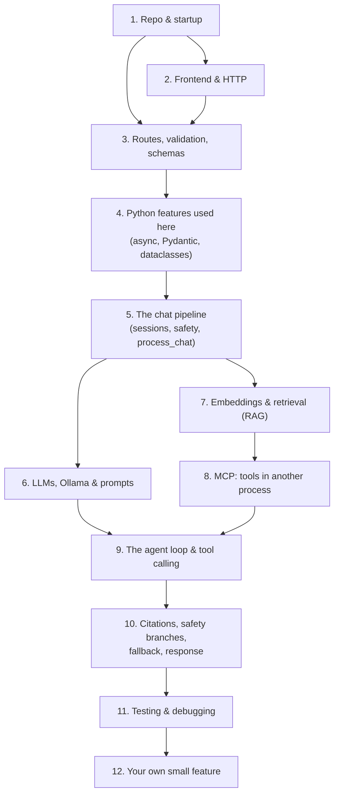

# LEARNING_ROADMAP.md — Learning your Advisor project, step by step

> **Question this document answers:** *In what order should I learn the technologies and read the code so that I can explain, debug and change my AI Advisor on my own?*
>
> This roadmap is built around **this repository**, not a generic AI course. Each phase points at real files and functions, gives a small exercise, and ends with questions you should be able to answer **in your own words**.
>
> Companion documents: [ARCHITECTURE.md](ARCHITECTURE.md) (the map) · [CODEBASE_GUIDE.md](CODEBASE_GUIDE.md) (where things are) · [REQUEST_LIFECYCLE.md](REQUEST_LIFECYCLE.md) (one request in detail) · [FLOW.md](FLOW.md) (all execution paths) · [DECISIONS.md](DECISIONS.md) (why).

---

## A. Initial orientation

### The big picture in plain words

Your app is a **chat page** inside the school ERP. When a parent asks a question:

1. The **browser** sends the question to a **Python web server** (FastAPI).
2. The server first runs a **safety check** made of text patterns. Crisis messages get a fixed reply and **never reach the AI**.
3. For normal questions, the server **searches a small library of 20 trusted passages** to find the ones most similar in meaning to the question (that is "RAG": retrieval-augmented generation).
4. It also looks up the **real school policy** or builds a **template activity plan** if the question clearly asks for one.
5. It gives all of that to an **AI model running on your own machine** (via **Ollama**) inside an **agent** — a loop that lets the model ask for extra tools if it wants.
6. The tools live in a **separate helper program** that the server talks to using **MCP**, a standard protocol for tools.
7. The server attaches **citations** taken from the search results (never from the model's own words), and sends everything back to the page.

### Minimum concepts before you read the agent code

You do **not** need to understand LangChain, MCP or embeddings to start. You need:

| Concept | Why you need it here | Where you'll see it first |
|---|---|---|
| A function, its arguments and its return value | Every step is a function | `backend/app/safety.py::classify_safety` |
| Importing a module | Files use each other through `import` | top of `backend/app/main.py` |
| JSON | The browser and server exchange JSON | the payload in `useAdvisorChat.js::sendMessage` |
| HTTP request / response | How the page talks to the server | `advisorApi.js::advisorFetch` |
| A class with fields (Pydantic model) | Requests/responses are classes | `backend/app/models.py::ChatRequest` |
| `async` / `await` (basic idea) | Most server functions are async | `services/advisor.py::process_chat` |

### Before you start: set up a safe workspace

- Work on your **local machine** with the dev UI (`reference_frontend`) or the tests — **never** practise on the school's running server. Deploying and restarting the live service is handled by whoever manages that server.
- **Right now most of your code is not committed to git** (see DECISIONS R5). Before any exercise that changes code, commit the current state, then make a branch:
  ```bash
  git add -A
  git commit -m "Snapshot before learning exercises"
  git switch -c learning/exercises
  ```
  After an exercise: keep it with `git commit`, or throw it away with `git restore .` (only on your learning branch).
- Use a model that fits your GPU (the configured 27B model does not load on the 12 GB card — DECISIONS R23). `mistral:latest` is already installed and works for exercises; free alternatives you can pull with Ollama include small Qwen 3 or Llama 3.1 models that support tool calling.

---

## B. The phased plan

### Why this order (and how it differs from a generic course)



- **HTTP and routes come before the agent** because the agent only runs *inside* a request; if you don't know how a request arrives and leaves, agent code floats in the air.
- **Retrieval (7) comes before tool calling (9)** — different from most courses — because in this project **retrieval runs in our code before the model** (DEC-026). You can understand `search_knowledge` as a plain Python function first; MCP (8) then explains how it's called across processes; the agent (9) is last because it combines model + tools.
- **Phases 6 and 7 are independent** of each other — do them in either order.
- **Phase 2 (frontend) can be skipped temporarily** if you only work on the backend; come back before changing the UI.

Each phase below has the same parts: **Goal · Prerequisites · Read · Inspect · Concepts · You should be able to answer · Exercise · Check yourself · Watch out for.**

---

### Phase 1 — Repository structure and application startup

- **Goal:** know which folder does what and what happens when the server starts.
- **Prerequisites:** none.
- **Read:** `README.md`, [ARCHITECTURE.md §A–B](ARCHITECTURE.md#a-system-overview), [CODEBASE_GUIDE.md §A](CODEBASE_GUIDE.md#a-repository-structure), then `backend/app/main.py` and `backend/app/config.py`.
- **Inspect:** `main.py::lifespan`, `app = FastAPI(...)`, the five `@app.get/@app.post` functions; `config.py::Settings`, `settings`.
- **Concepts:** entry point vs helper function; module import runs top-level code; startup vs per-request; environment variables and `.env`.
- **You should be able to answer:**
  1. What command starts the backend, and which object does it look for?
  2. What does `lifespan` start, and why does it matter for tool calls?
  3. Where does the chat model name come from, and what must you do after changing it?
- **Exercise (read-only):** draw a box diagram of the three programs that run during a chat (API process, MCP child process, Ollama) and the browser. Compare with [ARCHITECTURE.md §C](ARCHITECTURE.md#c-architecture-diagram).
- **Check yourself:** start the API locally (`uvicorn app.main:app --port 8787` from `backend/`) and find the log line `MCP_PERSISTENT_SESSION started`. Explain what just happened.
- **Watch out for:** thinking `main.py` contains the logic — it only wires things; logic lives in `services/` and `agent.py`. `API_HOST`/`API_PORT` settings are unused; uvicorn flags decide.

### Phase 2 — Frontend basics and HTTP requests

- **Goal:** follow a click to an HTTP request and a response back to the screen.
- **Prerequisites:** Phase 1; basic JavaScript (functions, objects, `async/await`).
- **Read:** `erp-integration/src/components/Communication/advisor/ChildConnectApp.js`, `useAdvisorChat.js`, `advisorApi.js`, `components/ChatInput.js`, `components/AssistantResponse.js`. For running locally: `reference_frontend/vite.config.js`, `reference_frontend/src/hooks/useChat.js`, `reference_frontend/src/services/api.js`.
- **Inspect:** `ChatInput.handleSubmit`, `useAdvisorChat.sendMessage`, `advisorApi.advisorFetch`, `friendlyHttpError`, `AssistantResponse`.
- **Concepts:** React state and re-rendering; a *hook* (`useAdvisorChat`); `fetch`; frontend API client vs backend route; the dev proxy in Vite vs the ERP proxy.
- **You should be able to answer:**
  1. Which variable stores the session id in the browser, and when is it first set?
  2. What does the user see while waiting, and which state controls it?
  3. Why does the ERP page call `/api/advisor/chat` but the dev UI call `/api/chat`?
- **Exercise (read-only):** run the dev UI (`npm run dev` in `reference_frontend/`), send a question, and in the browser's Network tab read the request payload and response JSON. Match each field to `models.py`.
- **Check yourself:** explain why "Try again" can resend a question after an error (`lastPayloadRef`).
- **Watch out for:** the dev UI and the ERP UI are **separate copies** that have drifted (the dev UI lacks Markdown rendering and the "AI unavailable" notice). Changes to one don't appear in the other.

### Phase 3 — Backend routes, request validation and response schemas

- **Goal:** know exactly what the API accepts and returns, and what happens with bad input.
- **Prerequisites:** Phases 1–2.
- **Read:** `backend/app/models.py`, `backend/app/main.py`; [REQUEST_LIFECYCLE.md §D](REQUEST_LIFECYCLE.md#d-actual-request-and-response-schemas).
- **Inspect:** `ChatRequest`, `ChatResponse` (and `_sync_sources_alias`), `Citation`, `FeedbackRequest`, `SafeguardingConfirmRequest`; `main.py::chat`, `request_logging`.
- **Concepts:** validation before your code runs (HTTP 422); defaults; enums and literals; `response_model`; middleware.
- **You should be able to answer:**
  1. Which fields are required in `ChatRequest`, and what happens if `language` is `"fr"`?
  2. Why does `ChatResponse` have both `citations` and `sources`?
  3. Where is the `request_id` created and where does it appear later?
- **Exercise (read-only):** in a Python shell from `backend/`:
  ```python
  from app.models import ChatRequest
  ChatRequest.model_validate({"message": "hi"})                    # see the defaults
  ChatRequest.model_validate({"message": "", "language": "fr"})    # see the errors
  ```
- **Check yourself:** without looking, list the `ChatResponse` fields that are only set for urgent messages.
- **Watch out for:** a 422 is produced by FastAPI before `chat()` runs — adding prints inside `chat()` won't show anything for invalid requests.

### Phase 4 — Python features used in this project

- **Goal:** be comfortable with the specific Python patterns the project relies on.
- **Prerequisites:** Phase 3.
- **Read:** `backend/app/sessions/store.py` (dataclasses, lock), `backend/app/observability.py` (`ContextVar`), `backend/app/embeddings.py` (`lru_cache`), `backend/app/agent.py` (`@dataclass TurnContext`, `asyncio.gather` in `prepare_context`, `asyncio.Lock` in `_compiled_advisor_agent`).
- **Concepts:** `async def` / `await`; what `asyncio.gather` does; sync code inside async code blocks everything; dataclasses vs Pydantic models; module-level singletons (`settings`, `session_store`); caching.
- **You should be able to answer:**
  1. In `prepare_context`, which three operations are started together, and which of them actually does work for a plain question?
  2. Why is `classify_safety` a normal (sync) function while `process_chat` is async?
  3. What is stored in `trace_var` and why a `ContextVar` rather than a global?
- **Exercise (read-only):** list every `await` in `services/advisor.py::process_chat` and write next to each what it waits for (network? subprocess? nothing slow?). Check against [FLOW.md §13](FLOW.md#13-asynchronous-execution-and-error-propagation).
- **Check yourself:** explain why `record_feedback` (sync file write) inside an async route is acceptable but would be a problem if it were slow.
- **Watch out for:** "async" does not mean "parallel". Only `asyncio.gather` in `prepare_context` (and LangGraph's parallel tool calls) actually overlaps work.

### Phase 5 — The chat pipeline: sessions, safety, orchestration

- **Goal:** explain `process_chat` step by step, including its branches.
- **Prerequisites:** Phase 4.
- **Read:** `backend/app/services/advisor.py`, `backend/app/sessions/store.py`, `backend/app/safety.py`, `backend/eval/prompts.json`; [REQUEST_LIFECYCLE.md §B Stages 7–9](REQUEST_LIFECYCLE.md#stage-7--trace-and-session-state).
- **Inspect:** `process_chat`, `_escalation_response`, `check_ollama_available`; `SessionStore.resolve`/`append`; `classify_safety`, `URGENT_PATTERNS`.
- **Concepts:** orchestration = putting steps in the right order; session state vs model memory; deterministic safety gate; recall vs false positives.
- **You should be able to answer:**
  1. Why must the safety check come before the agent?
  2. What exactly is stored in a session, and what is sent to the model as history?
  3. What does `process_chat` do if the agent throws an exception?
- **Exercise (read-only):**
  ```python
  from app.safety import classify_safety
  for t in ["He loves shooting hoops", "She seems suicidal", "Is it abuse to raise my voice?"]:
      print(t, "->", classify_safety(t).risk_level)
  ```
  Explain each result using the regex in `safety.py` (the last one is a deliberate over-flag — DEC-002).
- **Check yourself:** draw `process_chat` as a flowchart with the urgent, referral, normal and fallback exits.
- **Watch out for:** sessions live in memory — they vanish on restart, and a valid UUID from any client is accepted.

### Phase 6 — LLMs, Ollama and prompts

- **Goal:** understand what the model receives and how it's configured.
- **Prerequisites:** Phase 5.
- **Read:** `backend/app/prompts.py`, `backend/app/agent.py` (`chat_ollama_kwargs`, `_build_user_message`, `_passages_block`, `trim_history_messages`), `backend/.env.example`; DECISIONS DEC-003, DEC-010.
- **Concepts:** model weights and local serving; tokens, `num_predict`, `num_ctx`; temperature; system prompt vs user prompt; why a model that doesn't fit GPU memory is slow or fails.
- **You should be able to answer:**
  1. Which parts of the prompt are fixed and which change every request?
  2. Why does changing `SYSTEM_PROMPT` need a server restart?
  3. What does the model see when no passage matched?
- **Exercise (read-only):** `ollama list` and `ollama ps` in a terminal; then read the `OLLAMA_PROFILE_SUMMARY` log line after a chat and explain input vs output tokens.
- **Check yourself:** write out, by hand, the full user prompt for "How can I teach counting at home?" using `_build_user_message` as your guide.
- **Watch out for:** `/api/health` returning `ollama: true` only means the Ollama *server* runs — not that the chat model can load.

### Phase 7 — Embeddings, vector search and RAG

- **Goal:** explain how a question finds passages, from ingestion to distances.
- **Prerequisites:** Phase 5 (Phase 6 helpful, not required).
- **Read:** `backend/ingestion/seed_chunks.json` (a few entries), `backend/ingestion/ingest.py`, `backend/app/embeddings.py`, `backend/mcp_server/tools/search_knowledge.py`; [FLOW.md §9](FLOW.md#9-knowledge-ingestion-and-retrieval); DECISIONS DEC-006, DEC-025, DEC-029, DEC-033.
- **Inspect:** `ingest_seed_data`, `embed_documents`, `embed_query`, `search_knowledge`, `_build_where_clause`, `settings.chroma_max_distance`.
- **Concepts:** an embedding is a list of numbers representing meaning; nearest-neighbour search; L2 distance (lower = closer); metadata filters vs relevance cutoff; ingestion (offline) vs retrieval (per request); why the same embedding model must be used for both.
- **You should be able to answer:**
  1. Why does "How do I fix my car's brakes?" now return no passages?
  2. What would break if you changed `OLLAMA_EMBED_MODEL` without re-ingesting?
  3. Why were the age and audience filters removed?
- **Exercise (read-only, needs Ollama running with `nomic-embed-text`):**
  ```python
  from mcp_server.tools.search_knowledge import search_knowledge
  for q in ["toddler bites other kids", "teach counting at home", "fix my car"]:
      r = search_knowledge(query=q)
      print(q, [(h["chunk_id"], round(h["distance"], 2)) for h in r["results"]])
  ```
  Explain why each top hit is (or isn't) the right passage.
- **Check yourself:** trace one passage from `seed_chunks.json` to a `SourceCard` on screen (Phase 10 will confirm).
- **Watch out for:** there is **no chunking** — each seed entry is one passage; and `distance` is not a probability or a correctness score.

### Phase 8 — MCP: tools in another process

- **Goal:** understand how the API calls tools that live in a separate program.
- **Prerequisites:** Phase 7.
- **Read:** `backend/app/mcp/client.py`, `backend/mcp_server/server.py`, `backend/mcp_server/tool_inputs.py`, `backend/app/tool_payload.py`; [FLOW.md §8](FLOW.md#8-mcp-execution-lifecycle); DECISIONS DEC-005, DEC-031.
- **Inspect:** `start_persistent_session`, `get_mcp_tools`, `invoke_mcp_tool`, `_disable_persistent_tools`; `list_tools`, `call_tool`, `_validate_arguments`, `TOOL_HANDLERS`.
- **Concepts:** MCP client vs server; stdio transport (JSON messages through stdin/stdout); tool discovery (`tools/list`) vs static registration; persistent session vs per-call mode; tool errors as data.
- **You should be able to answer:**
  1. When is the MCP server process started, and by whom?
  2. How does the client learn each tool's arguments?
  3. What happens if the MCP process dies while the API is running?
- **Exercise (read-only):** start the API and watch the console: identify a `MCP_TOOL_RESULT … persistent=True` line (API side) and the matching `MCP_SERVER_TOOL_DONE` line (child side) for one chat.
- **Check yourself:** explain why `profile_chat_latency.py` is slower per tool call than the running API (hint: no lifespan).
- **Watch out for:** "separate process" does not mean "separate code" — the MCP server imports `app.config` and `app.embeddings` from the same folder.

### Phase 9 — The agent loop and tool calling

- **Goal:** explain what the agent does, who decides tool calls, and what ends the loop.
- **Prerequisites:** Phases 6 and 8.
- **Read:** `backend/app/agent.py` (`run_advisor_agent`, `_compiled_advisor_agent`, `AGENT_TOOL_NAMES`), `backend/app/routing.py`; [FLOW.md §7](FLOW.md#7-agent-execution-lifecycle); [REQUEST_LIFECYCLE.md §E](REQUEST_LIFECYCLE.md#e-tool-invocation-and-retrieval--who-does-what); DECISIONS DEC-004, DEC-026–DEC-028.
- **Concepts:** model *requests* a tool vs framework *executes* it vs tool *performs* it; LangGraph model node / tool node; recursion limit; why some tools are called by our code before the model (routing) and one tool is never given to the model.
- **You should be able to answer:**
  1. For "What is our school policy on bullying?", which code calls `get_school_policy` — the model or `prepare_context`? Why?
  2. What ends the agent loop normally? What ends it abnormally?
  3. Why is `submit_safeguarding_flag` missing from `AGENT_TOOL_NAMES`?
- **Exercise (read-only):** run `pytest tests/test_chat_flow.py -v` from `backend/` and read each test; for each, say which branch of `prepare_context` / `run_advisor_agent` it exercises.
- **Check yourself:** explain the 2026-10-26 finding "the model never called a tool" and why the answers are now grounded anyway.
- **Watch out for:** thinking the model runs tools. It only writes a request; LangGraph and MCP do the work.

### Phase 10 — Citations, safety branches, fallback and response construction

- **Goal:** know where every field of the response comes from.
- **Prerequisites:** Phases 7 and 9.
- **Read:** `backend/app/citations.py`, `agent.py::_resolve_citations` and `run_fallback_via_mcp`, `prompts.py::build_fallback_response`, `services/safeguarding.py`, `mcp_server/tools/safeguarding.py`, UI `AssistantResponse.js`, `SafeguardingConfirm.js`; [REQUEST_LIFECYCLE.md §F–G](REQUEST_LIFECYCLE.md#f-citations-and-source-attribution).
- **Concepts:** provenance (citations from data, not text); stripping model-written source lists; degraded answers; human-confirmed side effects.
- **You should be able to answer:**
  1. Can the model invent a citation that appears in the source cards? Why not?
  2. When is `degraded` true, and what does the user see?
  3. What has to happen before a safeguarding concern is written to disk?
- **Exercise (read-only):** pick `kb-pbis-sharing-016` and trace it: `seed_chunks.json` → Chroma metadata → `search_knowledge` row → `citation_from_retrieval_hit` → `ChatResponse.citations` → `SourceCard`. Write the field mapping (e.g. `source_url` → `url`).
- **Check yourself:** explain why "Sources used" in the UI means "given to the model", not "used by the model".
- **Watch out for:** policy text is quoted in the answer but is never a citation.

### Phase 11 — Testing, debugging and reliability

- **Goal:** find the cause of a problem quickly and prove a fix with a test.
- **Prerequisites:** Phases 5–10.
- **Read:** `backend/tests/conftest.py`, `tests/test_chat_flow.py`, `tests/test_api.py`, `tests/unit/test_routing.py`, `tests/test_safety_metrics.py`, `tests/integration/test_mcp_path.py`; [FLOW.md §14](FLOW.md#14-debugging-guide); [CODEBASE_GUIDE.md §F](CODEBASE_GUIDE.md#f-debugging-map).
- **Concepts:** unit vs integration tests; fakes and monkeypatching; test isolation (temp `AUDIT_DIR`); following one `request_id` through logs.
- **You should be able to answer:**
  1. Which tests need Ollama, and which don't?
  2. How do the fast tests avoid writing to the real audit log?
  3. Given a `degraded: true` response, which three log lines do you look for first?
- **Exercise (read-only):** run `pytest tests --ignore=tests/integration -q`, then (with Ollama + `mistral`) `OLLAMA_CHAT_MODEL=mistral:latest pytest tests/integration -q`. Note the time difference and explain it.
- **Check yourself:** stop Ollama, send a chat from the dev UI, and explain every log line you see until the degraded answer is returned. Start Ollama again afterwards.
- **Watch out for:** a passing fake-model test proves the plumbing, not the answer quality.

### Phase 12 — Make a small feature change on your own

- **Goal:** change behaviour end to end, with a test, on a branch.
- **Prerequisites:** all previous phases; a git branch (see §A).
- **Read:** [CODEBASE_GUIDE.md §D](CODEBASE_GUIDE.md#d-where-to-make-changes).
- **Exercise (code change — capstone):** add a new school policy type, `screen_time`:
  1. add a `"screen_time"` entry to `backend/data/policies/poc_test_school.json`;
  2. add `"screen_time"` to `PolicyType` in `backend/mcp_server/tool_inputs.py`;
  3. add a keyword pattern in `backend/app/routing.py::_POLICY_TYPE_PATTERNS`;
  4. add test cases to `backend/tests/unit/test_routing.py`;
  5. run the fast tests; restart the API; ask "What is our screen time policy?" and confirm the answer quotes your text and `CONTEXT_READY … policy=screen_time` appears in the log.
- **Check yourself:** explain why step 2 is needed even though the JSON file already has the key (hint: argument validation in the MCP server).
- **Watch out for:** forgetting the restart (tools and settings are read at startup), and testing against the live school server instead of your local setup.

---

## C. Per-phase summary table

| Phase | Core files | Time guide* | Can be skipped for now if… |
|---|---|---|---|
| 1 | `main.py`, `config.py` | 1–2 h | never |
| 2 | `useAdvisorChat.js`, `advisorApi.js` | 2–3 h | you only work on the backend this week |
| 3 | `models.py`, `main.py` | 1–2 h | never |
| 4 | `store.py`, `observability.py`, `agent.py` (patterns) | 2–4 h | you already know async Python |
| 5 | `services/advisor.py`, `safety.py`, `store.py` | 2–3 h | never |
| 6 | `prompts.py`, `agent.py` (prompt parts) | 2 h | — |
| 7 | `ingest.py`, `search_knowledge.py`, `embeddings.py` | 3–4 h | — |
| 8 | `mcp/client.py`, `mcp_server/server.py` | 2–3 h | — |
| 9 | `agent.py`, `routing.py` | 3–4 h | never |
| 10 | `citations.py`, safeguarding files, `AssistantResponse.js` | 2–3 h | — |
| 11 | `tests/*` | 2–3 h | never |
| 12 | your change | 2–4 h | — |

\*Rough guide for a learner reading carefully; not a measurement.

---

## D. How the concepts depend on each other

| To understand… | You first need… | Because… |
|---|---|---|
| The agent loop (9) | HTTP & routes (3), prompts (6), MCP (8) | The agent runs inside a request, is driven by a prompt, and calls tools over MCP. |
| MCP (8) | Plain tool functions (7), async (4) | MCP is "how a function in another process is called"; know the function first. |
| Citations (10) | Retrieval (7) | Citations are reshaped search rows. |
| Fallback answers (10) | The pipeline (5), agent failures (9) | The fallback replaces the agent when it fails. |
| Debugging (11) | Everything above | You need to know which step produced which log line. |
| Frontend (2) | Only HTTP basics | It can be learned in parallel with Phases 4–7. |
| Prompts (6) and RAG (7) | The pipeline (5) | Independent of each other. |

---

## E. Hands-on exercises (collected)

**Read-only — safe at any time:**

| # | Exercise | Phase |
|---|---|---|
| R1 | Run `pytest tests --ignore=tests/integration -q` and read `tests/test_chat_flow.py` | 9, 11 |
| R2 | Trace one request on paper using [REQUEST_LIFECYCLE.md](REQUEST_LIFECYCLE.md), then check each step in the code | 5–10 |
| R3 | Draw the call chain of `prepare_context()` down to `search_knowledge()` | 7–8 |
| R4 | Validate good and bad payloads with `ChatRequest.model_validate` | 3 |
| R5 | Classify ten sentences of your own with `classify_safety` and explain each result | 5 |
| R6 | Run `search_knowledge` for five questions and rank the distances | 7 |
| R7 | Trace `kb-pbis-sharing-016` from JSON to the source card | 10 |
| R8 | Follow one `request_id` through the logs of a dev-UI chat | 11 |

**Code changes — on a branch, after a commit (see §A):**

| # | Exercise | Files | How to verify | How to undo |
|---|---|---|---|---|
| C1 | Add a harmless log line in `prepare_context` printing `len(hits)` | `backend/app/agent.py` | log appears on each chat | `git restore backend/app/agent.py` |
| C2 | Add a new quick-start question | `erp-integration/src/components/Communication/advisor/quickTopics.js` (and `reference_frontend/src/data/quickTopics.js` for the dev UI) | it appears in the sidebar of the dev UI | `git restore` |
| C3 | Write a test for a policy phrase the router misses today: `detect_policy("What are the rules on screen time?")` returns `(False, None)` (verified 2026-10-26) because "the rules" is not "school rules". Write the test you *want*, see it fail, then decide whether to widen `_POLICY_RE` | `backend/tests/unit/test_routing.py`, `backend/app/routing.py` | `pytest tests/unit/test_routing.py` | `git restore` |
| C4 | Add a follow-up template for a new topic (e.g. "sleep") | `backend/app/agent.py::FOLLOW_UP_TEMPLATES`, `_infer_topic` | a fake-model test or a dev-UI chat | `git restore` |
| C5 | Add one knowledge passage and ingest it (without `--reset`) | `backend/ingestion/seed_chunks.json` then `python -m ingestion.ingest` | `search_knowledge` returns it for a matching question | remove the entry, run `python -m ingestion.ingest --reset`, restart the API |
| C6 | Capstone: new `screen_time` policy (Phase 12) | policy JSON, `tool_inputs.py`, `routing.py`, tests | tests + live chat + log | `git restore` / delete branch |

Do **not**: run `erp-integration/apply-to-erp.ps1` against the live ERP, restart the school server's services, commit `.env` files, or put real child data into prompts while testing.

---

## F. Self-assessment checkpoints

Answer out loud or in writing **without opening the docs**; then check against the code.

| After phase | Questions |
|---|---|
| 1 | Name the three programs involved in a chat. What does the lifespan do on shutdown? |
| 2 | What happens in the browser between pressing Enter and seeing "Thinking…"? Why might the draft box be empty after an error? |
| 3 | Give two inputs that cause 422. Why does a 422 not appear in the session history? |
| 4 | Which calls in `process_chat` can take seconds, and why? What does `asyncio.gather` change? |
| 5 | Explain to a teacher why "toy gun" no longer triggers the crisis message, but "Is it abuse to raise my voice?" does. |
| 6 | If answers are cut off mid-sentence, which setting do you suspect first? |
| 7 | A parent asks about bedtime and gets only one source. Explain using distances and the cutoff. |
| 8 | Describe what crosses the stdin/stdout pipe for one search. |
| 9 | Who decides to search for a normal question now — the model or the code? What can the model still decide? |
| 10 | A colleague says "the AI cited a fake CDC link". How do you prove whether that's possible? |
| 11 | The UI says "AI advisor is unavailable". List your first three checks in order. |
| 12 | Explain your capstone change file by file, including why each file was needed. |

---

## G. Completion criteria

You've completed the roadmap when you can, **without the docs open**:

1. **Trace a request** from the Send button to the rendered answer, naming the files and main functions (≈ 15 steps).
2. **Locate code** for any feature in under two minutes (UI text, prompt, safety rule, retrieval cutoff, policy routing, session limits).
3. **Explain the tool execution path**: which tools run in code before the model, which the model may request, how MCP carries the call, and why the safeguarding tool is excluded.
4. **Diagnose common issues** from logs and responses: 422, degraded answers, no sources, wrong policy, slow replies, MCP per-call mode.
5. **Safely modify a small feature** on a branch, with a passing test, and explain the change in terms of the architecture.
6. **Explain at least five design decisions** from [DECISIONS.md](DECISIONS.md) in your own words, including one trade-off you would revisit.

---

## H. Resources (official and free)

Only for technologies this project actually uses.

| Topic | Resource |
|---|---|
| Python async | Python docs — `asyncio`: https://docs.python.org/3/library/asyncio.html |
| FastAPI | Official tutorial: https://fastapi.tiangolo.com/tutorial/ (read: First Steps, Request Body, Response Model, Middleware, Lifespan Events) |
| Pydantic | https://docs.pydantic.dev/ (Models, Validators, Settings management) |
| React | https://react.dev/learn (State, Hooks, Responding to Events) |
| `fetch` / HTTP | MDN Fetch API: https://developer.mozilla.org/en-US/docs/Web/API/Fetch_API |
| Vite dev proxy | https://vite.dev/config/server-options (`server.proxy`) |
| LangChain agents / LangGraph | LangChain docs: https://docs.langchain.com/ (Python → LangChain → Agents and Tools; LangGraph overview) |
| MCP | Specification and concepts: https://modelcontextprotocol.io/ · Python SDK: https://github.com/modelcontextprotocol/python-sdk · LangChain adapter: https://github.com/langchain-ai/langchain-mcp-adapters |
| Ollama | https://github.com/ollama/ollama (README and `docs/` — API, model library, environment variables such as `OLLAMA_MODELS`) |
| Embedding model | https://ollama.com/library/nomic-embed-text |
| Chroma | https://docs.trychroma.com/ (Collections, Querying, Metadata filtering) |
| pytest | https://docs.pytest.org/ (fixtures, monkeypatch) |

Tip: read the official page **for the function you are looking at** (e.g. FastAPI "Lifespan Events" while reading `main.py::lifespan`) rather than whole courses.
